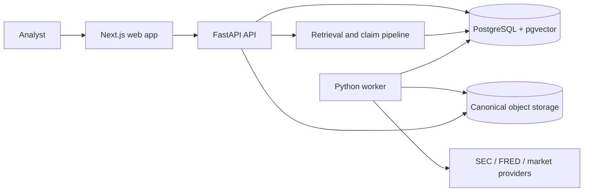

# Financial Evidence Lab

**Author:** [Hirokazu J Wilson](https://github.com/wilsonhj)

[](https://github.com/wilsonhj/financial-evidence-lab/actions/workflows/ci.yml)
[](./LICENSE)

Financial Evidence Lab is an evidence-first workspace for researching public
companies. It connects filing ingestion, point-in-time search, verifiable
claims, structured extraction, and financial modeling without losing the
source behind a number or conclusion.

The project is deliberately **mock-first**. You can explore the reader and
Search Observatory without credentials, then add PostgreSQL and live providers
when you need the complete data path.

> This is active pre-release software. The reader, hybrid-retrieval, and
> structured-extraction foundations are implemented mock-first, while financial
> modeling and forecasting remain roadmap work.

## What works today

This section summarizes capabilities, not delivery state. For what is merged,
open, or blocked right now, read [`docs/handoff/STATUS.md`](./docs/handoff/STATUS.md)
— the only live status source in this repository — and the GitHub issues and
pull requests it cites.

Delivery is organized into six milestones, M0 (platform and contracts) through
M5 (Forecast Lab and MVP release); see the [glossary](./docs/glossary.md#milestones-m0m5)
and the [canonical plan](./specs/001-financial-evidence-lab/plan.md#3-milestones).

| Area                          | What it does                                                                                                                                                                                                                  |
| ----------------------------- | ----------------------------------------------------------------------------------------------------------------------------------------------------------------------------------------------------------------------------- |
| Platform foundation           | Workspace APIs, mock and Supabase token verification behind database-authoritative membership, tenant-scoped RLS, audit/cost primitives, a PostgreSQL job queue, explicit deployment modes, and CI.                          |
| Evidence ingestion and reader | SEC ingestion, immutable document versions, canonical spans and facts, a version-pinned composite reader API, and the Next.js evidence reader.                                                                                |
| Hybrid retrieval and claims   | Dense, lexical, fact, and table lanes with deterministic planning and reciprocal-rank fusion, replayable traces, feedback, claim decomposition with citation verification, and the Search Observatory.                       |
| Structured extraction         | The `packages/ontology` SaaS metric ontology and a durable extraction worker: typed roles, a checkpointed workflow, normalization, deterministic validators, hard budgets, atomic persistence, and human review of proposals. |
| Providers                     | Provider protocols with deterministic mocks, plus explicit-key OpenAI structured-generation and embedding adapters and an offline credential cipher. Runtime wiring of live providers is separate work.                      |
| Modeling and forecasting      | The `packages/calculation-engine` typed model graph and Decimal calculation engine. Model, scenario, and forecast product workflows (M4/M5) are specified but are not runnable product features.                             |

Live acceptance gates (hosted reader smoke, live corpus and retrieval gates,
load targets, calibration) are tracked separately from merged code; a merged
package does not certify its milestone's live gate.

The authoritative product requirements live in
[`specs/001-financial-evidence-lab/`](./specs/001-financial-evidence-lab/).

## Try the UI in five minutes

You need Node 24.20.0 (see `.node-version`) and Corepack. The fixture mode does
not require Python, PostgreSQL, or API keys.

```sh
corepack enable
corepack pnpm install --frozen-lockfile
FEL_DEPLOYMENT_MODE=fixture FEL_API_BEARER_TOKEN= FEL_EVIDENCE_SOURCE=fixture corepack pnpm --filter @fel/web dev
```

Open:

- <http://localhost:3000> for the filing list and evidence reader
- <http://localhost:3000/observatory> for retrieval inspection

Fixture mode is explicit by design; there is no silent production fallback.
If `FEL_DEPLOYMENT_MODE` is unset the web app runs in public mode, where
business routes return HTTP 503 until request-scoped sessions exist
([ADR-0027](./docs/decisions/ADR-0027-deployment-modes.md)).
For a database-backed setup, see
[`docs/development/local.md`](./docs/development/local.md).

## How the system fits together



Three rules shape the design:

1. **Point-in-time by default.** A query or direct document read must not see
   information published after its effective cutoff.
2. **Evidence is immutable.** Document content, spans, hashes, facts, retrieval
   traces, and calculation lineage are versioned instead of silently rewritten.
3. **Failures are explicit.** Missing credentials, unsupported provider modes,
   corrupt evidence, and incomplete configuration fail closed rather than
   returning plausible-looking results.

Read the [architecture overview](./docs/architecture/overview.md) for component
boundaries and the [system design](./docs/architecture/system-design.md) for
data flow, tenancy, temporal behavior, and failure semantics.

## Repository map

```text
apps/api/                    FastAPI routes and database-backed services
apps/web/                    Next.js reader and Search Observatory
workers/                     Job consumer, ingestion pipelines, extraction runtime
packages/calculation-engine/ Typed model graph and Decimal calculation engine
packages/contracts/          Versioned JSON Schema/OpenAPI contracts
packages/ontology/           SaaS metric ontology, comparability keys, loader
packages/providers/          Provider protocols and deterministic mocks
packages/retrieval/          Chunking, retrieval, fusion, traces, and claims
packages/retrieval-evals/    Retrieval benchmark and evaluation tooling
db/migrations/               Append-only PostgreSQL migrations
db/seeds/                    Seed data for local and test databases
evals/                       Cross-stack fixtures and graders
infra/                       Railway service definitions
scripts/                     Repository tooling invoked by make and CI
specs/                       Canonical product/specification packages
.github/                     CI workflows (ci.yml is the authoritative gate)
.specify/                    Constitution and Spec Kit memory
.agents/                     Spec Kit agent skills
docs/architecture/           System overview and design
docs/decisions/              Architecture decision records
docs/development/            Local setup and testing guides
docs/handoff/                Agent work queue and status snapshots
docs/research/               Research studies and package proposals
docs/runbooks/               Operator runbooks for deployed services
```

## Development setup

Supported toolchain:

- Node.js 24.20.0 (`.node-version` for CI, `.nvmrc` for nvm)
- pnpm 10.33 through Corepack (`packageManager` in `package.json`)
- Python 3.11 (`.python-version`)
- PostgreSQL with pgvector for database-backed tests and services

```sh
corepack enable
corepack pnpm install --frozen-lockfile

python3.11 -m venv .venv
.venv/bin/pip install --upgrade pip
.venv/bin/pip install -r requirements-dev.txt
```

If `python3.11` is not on your `PATH`, do not substitute another interpreter
silently — `.python-version` pins 3.11 and CI builds against it.
[`docs/development/local.md`](./docs/development/local.md) is the canonical
source for the toolchain, including how to obtain 3.11 and what to check if
`python3` resolves elsewhere. Prefer it over this summary if the two ever
disagree.

Run the fast, database-independent checks:

```sh
corepack pnpm run test
.venv/bin/pytest
```

Database-gated Python tests skip when `TEST_DATABASE_URL` is absent. CI runs
those suites against PostgreSQL 17 with pgvector. See the
[testing guide](./docs/development/testing.md) for the complete matrix and
recommended developer loops.

## API and runtime modes

The implemented API includes:

- workspace create/list/update with idempotency and optimistic concurrency
- corpus, span, and version-pinned composite reader endpoints
- retrieval query, rerun, event, result, and feedback endpoints
- health and structured error responses

The API has two token verifiers. `FEL_AUTH_MODE=mock` accepts unsigned mock
tokens for local fixtures and explicitly configured smoke modes.
`FEL_AUTH_MODE=supabase` verifies asymmetric Supabase access tokens against the
configured issuer's JWKS
([ADR-0025](./docs/decisions/ADR-0025-production-token-verification.md),
[deployment notes](./docs/handoff/production-auth.md)). In both modes database
membership, not the token, decides the caller's role. Public sign-up and
request-scoped web sessions have not shipped.

The web reader has two explicit server-side modes:

- `FEL_EVIDENCE_SOURCE=fixture` — deterministic local demonstration
- `FEL_EVIDENCE_SOURCE=http` — authenticated FastAPI reader calls

Server tokens must never be exposed to client components. Full environment
configuration is documented in
[`docs/development/local.md`](./docs/development/local.md).

## Current blockers and open decisions

Blockers, open decisions, and the critical path change with every merge, so
this README does not list them. Read
[`docs/handoff/STATUS.md`](./docs/handoff/STATUS.md) (newest section first) and
[`docs/handoff/workstreams.yaml`](./docs/handoff/workstreams.yaml), then
re-query GitHub before acting on any dated statement there.

## Contributing

1. Read [`AGENTS.md`](./AGENTS.md) and the
   [contributor operating model](./docs/handoff/README.md).
2. Start from the current `main` and claim one GitHub issue/work package.
3. Keep path ownership non-overlapping. Shared contract, migration, ADR, and
   handoff files require the repository's contract-change process.
4. Add tests for behavior changes and run the relevant local gates.
5. Open a draft pull request early, then attach exact test and review evidence.

Good first contributions are focused documentation, test coverage, developer
tooling, or a narrowly scoped issue with no shared-path collision. Report
security issues privately to the repository maintainers rather than opening a
public exploit report.

## Further reading

- [Architecture overview](./docs/architecture/overview.md)
- [System design](./docs/architecture/system-design.md)
- [Local development](./docs/development/local.md)
- [Testing guide](./docs/development/testing.md)
- [Extraction worker runbook](./docs/runbooks/extraction-worker.md)
- [Canonical specification](./specs/001-financial-evidence-lab/spec.md)
- [MVP stack ADR](./docs/decisions/ADR-0002-mvp-stack.md)
- [Contract package](./packages/contracts/README.md)
- [Documentation index](./docs/README.md) — every doc, grouped by audience
- [Glossary](./docs/glossary.md) — milestones, task IDs, governance terms
- [Architecture decision records](./docs/decisions/README.md)
- [Measured quality gates](./docs/development/quality-gates.md)
- [Operator runbooks](./docs/runbooks/)
- [API service](./apps/api/README.md), with
  [hardening](./apps/api/HARDENING.md),
  [performance](./apps/api/PERFORMANCE.md), and
  [extraction load](./apps/api/EXTRACTION_LOAD.md) notes
- [Shared packages](./packages/README.md)

`SPEC.md`, `PLAN.md`, and `TASKS.md` at the repository root are pointer stubs
into [`specs/001-financial-evidence-lab/`](./specs/001-financial-evidence-lab/).
They carry no normative content — read the spec package instead.

## License

Apache-2.0. See [`LICENSE`](./LICENSE).
