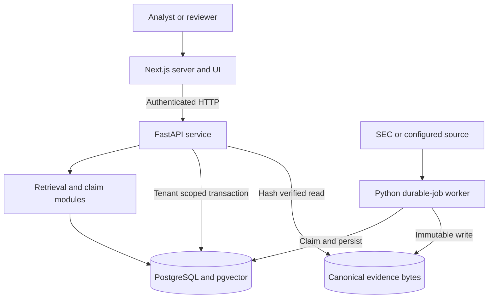
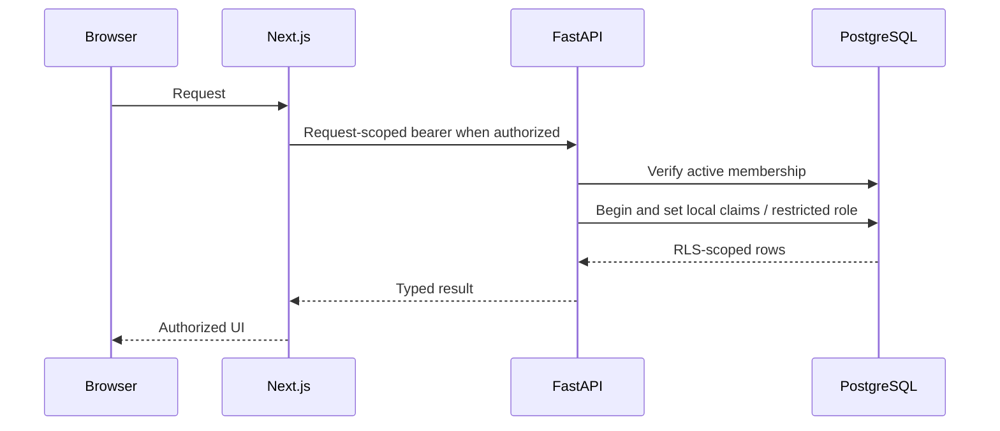
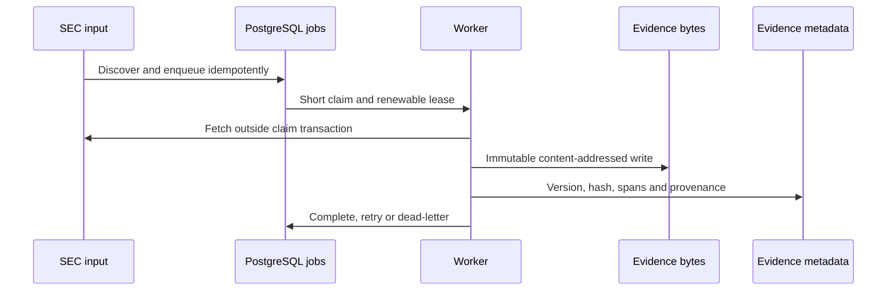
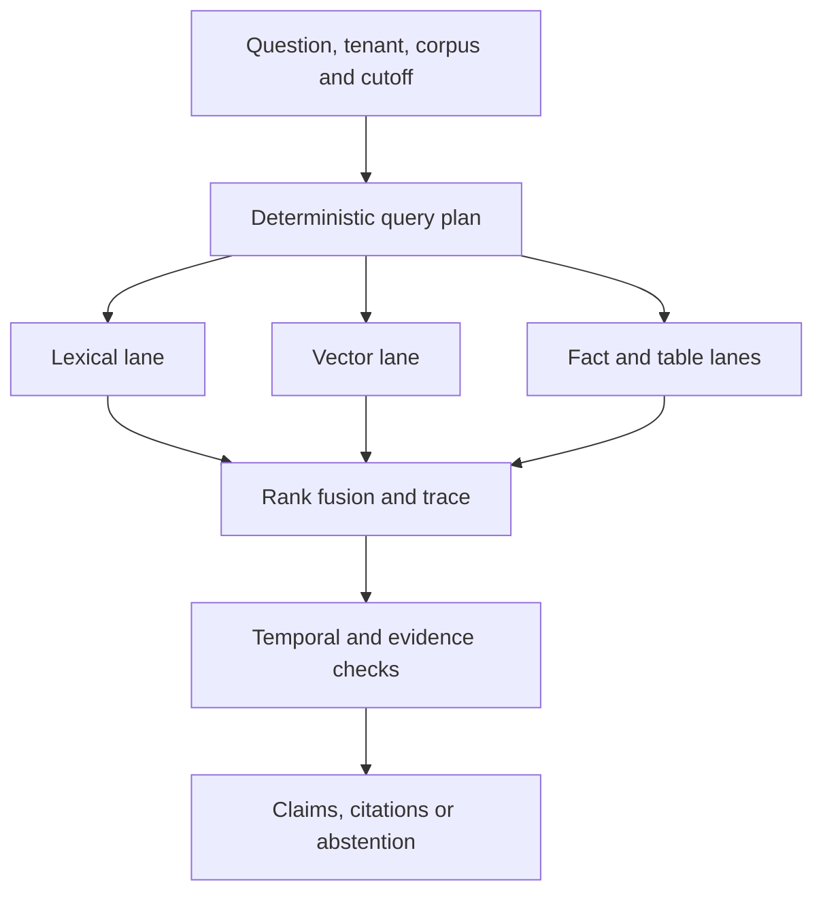
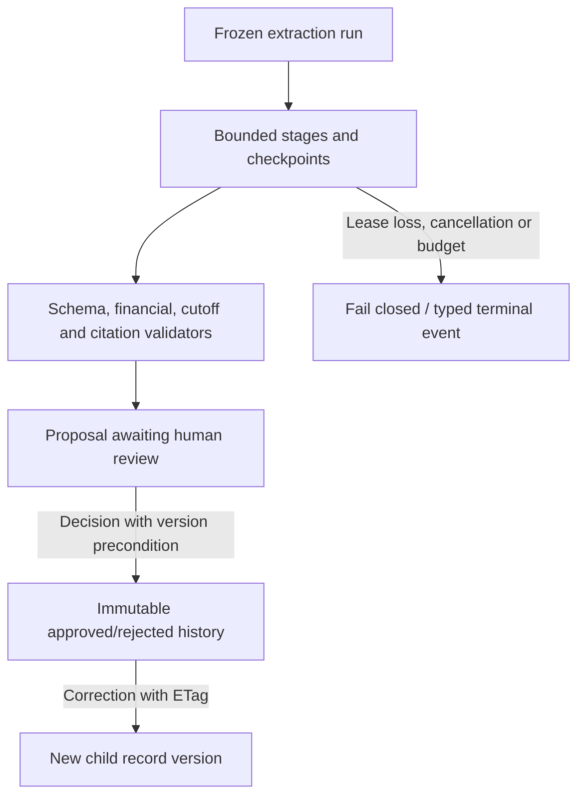
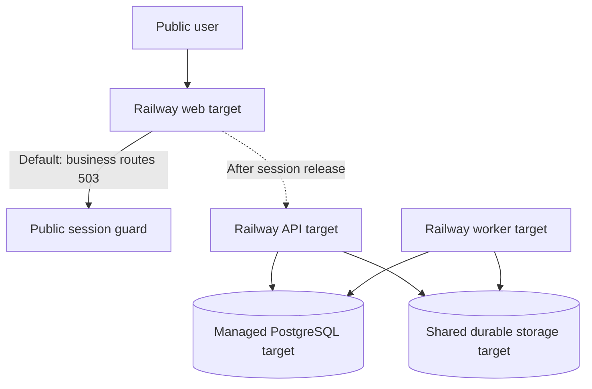

# Financial Evidence Lab engineering system design

**Technical reference** · Inspected baseline [`437ce55`](https://github.com/wilsonhj/financial-evidence-lab/commit/437ce558b9b63a54e4887c9e4226d5f528422629) · 22 September 2026

This reference explains the present architecture, design invariants, runtime boundaries, and acceptance dependencies. It is subordinate to the repository's [canonical specification](https://github.com/wilsonhj/financial-evidence-lab/blob/437ce558b9b63a54e4887c9e4226d5f528422629/specs/001-financial-evidence-lab/spec.md), [accepted stack ADR](https://github.com/wilsonhj/financial-evidence-lab/blob/437ce558b9b63a54e4887c9e4226d5f528422629/docs/decisions/ADR-0002-mvp-stack.md), versioned contracts, migrations, and live issue/PR state. It does not change a contract or release gate.

## 1. Architecture principles

The system chooses evidence and temporal validity over plausible-but-unverifiable output. It keeps source bytes immutable, indexes/version pins explicit, deterministic arithmetic outside language models, org-owned analysis under database row-level security, and expensive workflows inside durable budgets. Model-generated fields are proposals and untrusted input until contract, financial, citation, and review checks pass. [Constitution](https://github.com/wilsonhj/financial-evidence-lab/blob/437ce558b9b63a54e4887c9e4226d5f528422629/.specify/memory/constitution.md).

### Logical containers

| Boundary | Implemented responsibility | Important non-claim |
| --- | --- | --- |
| `apps/web` | Reader, Search Observatory, extraction review, server-side API calls and explicit deployment modes | Default public business access is unavailable pending request-scoped sessions |
| `apps/api` | FastAPI entry point, identity verification, membership, reader/retrieval/review services and event streams | An API verifier does not make a shared web bearer a per-user session |
| `workers` | PostgreSQL job consumer, ingestion, bounded extraction, leases and checkpoints | Not a directly invoked request handler |
| `packages/retrieval` | Hybrid retrieval, ranking, traces and claims | Mock-first tests do not prove live provider quality |
| `packages/ontology`, `packages/providers`, `packages/contracts` | Typed metrics, narrow provider interfaces and mocks/adapters, versioned schemas | An adapter is not a promoted/authorized public provider |
| `packages/calculation-engine` | Decimal/unit/formula/graph/scenario primitives | No complete model-composer and forecast product |
| `db/migrations` | Versioned relational schema, constraints, tenant policy and job/review state | A table is not a hosted service or a passed acceptance gate |
| `evals`, `.github` | Synthetic and database-enabled tests, CI and gated acceptance tooling | CI is not a substitute for live corpus and human-adjudicated quality |

Migrations through `0011_extraction_review.sql` and a Railway web/API/worker configuration exist at the inspected commit. Deployment equivalence and shared evidence access must be proven for an actual target. [Migration directory](https://github.com/wilsonhj/financial-evidence-lab/tree/437ce558b9b63a54e4887c9e4226d5f528422629/db/migrations), [Railway config](https://github.com/wilsonhj/financial-evidence-lab/tree/437ce558b9b63a54e4887c9e4226d5f528422629/infra/railway).

The arrows show allowed logical dependencies, not every operation or return path. The database jobs table is the API/worker coordination channel. The extraction module executes inside the worker. The retrieval module executes in the API path; neither is drawn as a separately deployed microservice. API and worker must resolve the *same* canonical storage keys. A local-directory provider exists; an object-storage protocol does not itself supply a hosted shared-volume deployment. [Storage implementation](https://github.com/wilsonhj/financial-evidence-lab/blob/437ce558b9b63a54e4887c9e4226d5f528422629/workers/src/fel_workers/storage.py), [architecture overview](https://github.com/wilsonhj/financial-evidence-lab/blob/437ce558b9b63a54e4887c9e4226d5f528422629/docs/architecture/overview.md).

## 2. Trust and tenancy

Authentication proves who sent a request. Authorization comes from active membership in the database, not a client-declared role. Application transactions set local org/user claims and execute as the restricted application role under RLS. The shared source corpus is not equivalent to a customer's private research workspace. Workers use a different least-privilege role path, with the rollout switch explicitly opt-in. Cross-tenant tests must use the real non-owner role; a handler-only mock is insufficient. [API auth](https://github.com/wilsonhj/financial-evidence-lab/blob/437ce558b9b63a54e4887c9e4226d5f528422629/apps/api/app/auth.py), [production verifier](https://github.com/wilsonhj/financial-evidence-lab/blob/437ce558b9b63a54e4887c9e4226d5f528422629/apps/api/app/supabase_auth.py), [worker role ADR](https://github.com/wilsonhj/financial-evidence-lab/blob/437ce558b9b63a54e4887c9e4226d5f528422629/docs/decisions/ADR-0020-worker-role-rollout.md).

That diagram is a **target public request path**, not a claim that current web business routes perform a per-user bearer exchange. Public deployment defaults to unavailable, returning 503 for business requests; explicit fixture, reader-smoke and synthetic-http modes are isolated test/deployment configurations. Public API clients can use Supabase token verification independently. Do not set a shared server token in a public Next.js application to imitate user identity. [Accepted ADR 0027](https://github.com/wilsonhj/financial-evidence-lab/blob/437ce558b9b63a54e4887c9e4226d5f528422629/docs/decisions/ADR-0027-deployment-modes.md), [web guard](https://github.com/wilsonhj/financial-evidence-lab/blob/437ce558b9b63a54e4887c9e4226d5f528422629/apps/web/src/lib/deployment-mode.ts), [parent #324](https://github.com/wilsonhj/financial-evidence-lab/issues/324).

## 3. Source-to-citation invariants

Every research result needs an effective cutoff. A direct read or retrieval result must not reveal a document published after that instant. A logical document has immutable parsed versions; a published corpus is a pinned collection of approved versions; retrieval indexes bind to a published corpus. Database metadata refers to content-addressed canonical bytes. A span's global offsets refer to the *selected* version, and the extracted bytes must match the stored hash. Missing or corrupt evidence is an integrity failure, not a substitute blank answer. [Reader design](https://github.com/wilsonhj/financial-evidence-lab/blob/437ce558b9b63a54e4887c9e4226d5f528422629/docs/architecture/system-design.md), [corpus migration](https://github.com/wilsonhj/financial-evidence-lab/blob/437ce558b9b63a54e4887c9e4226d5f528422629/db/migrations/0002_corpus_core.sql).

The worker fetches outside a long-running claim transaction. Queue retries cannot turn a changed source into the same logical version. Provider/filing output is never treated as executable instruction. Source integrity and published corpus pinning protect replay. The complete hosted worker-to-browser path must still be supported by retained deployment evidence; a closed issue alone is not that evidence. [Worker design](https://github.com/wilsonhj/financial-evidence-lab/blob/437ce558b9b63a54e4887c9e4226d5f528422629/docs/architecture/system-design.md), [issue #108](https://github.com/wilsonhj/financial-evidence-lab/issues/108).

### Reader and retrieval

The reader's composite API resolves the document, sections, spans and facts from one repeatable-read snapshot under the effective cutoff and selected corpus version. On retrieval, deterministic planning queries lexical, vector, facts and tables, fuses candidates with reciprocal-rank fusion, records rejection/score traces and decomposes supported claims with citations. The Search Observatory exposes this trace. Mock-first runs establish deterministic behavior; the live 20-issuer corpus, provider pins and complete frozen release benchmark are independent gates. [Reader architecture](https://github.com/wilsonhj/financial-evidence-lab/blob/437ce558b9b63a54e4887c9e4226d5f528422629/docs/architecture/system-design.md), [retrieval package](https://github.com/wilsonhj/financial-evidence-lab/tree/437ce558b9b63a54e4887c9e4226d5f528422629/packages/retrieval), [spec gates](https://github.com/wilsonhj/financial-evidence-lab/blob/437ce558b9b63a54e4887c9e4226d5f528422629/specs/001-financial-evidence-lab/spec.md#196-release-gates).

## 4. Extraction and review boundary

Extraction is a stateful worker workflow, not a single prompt. The run freezes corpus, cutoff, ontology/model context and budget. Fixed stages assemble evidence, classify, gather candidates, normalize, validate, verify citations, detect conflicts and persist proposals. Checkpoints make retries resumable; lease fences block stale workers from publishing late output. Attempts, tokens, cost and elapsed time are checked pre-call and post-call, and usage cannot be reset by a retry of the same run. All persisted proposals require review; a model response does not directly become an approved fact. [Workflow](https://github.com/wilsonhj/financial-evidence-lab/blob/437ce558b9b63a54e4887c9e4226d5f528422629/workers/src/fel_workers/extraction/workflow.py), [budget](https://github.com/wilsonhj/financial-evidence-lab/blob/437ce558b9b63a54e4887c9e4226d5f528422629/workers/src/fel_workers/extraction/budget.py), [design](https://github.com/wilsonhj/financial-evidence-lab/blob/437ce558b9b63a54e4887c9e4226d5f528422629/docs/architecture/system-design.md#extraction-boundary).

Review workflows and approved-record version history have code and database migrations, but the canonical acceptance still keeps #61 open because the reference 25-user performance gate is not established. Offline calibration primitives and tests are separately owned; synthetic fixture labels are not human-adjudicated calibration. [Review routes](https://github.com/wilsonhj/financial-evidence-lab/tree/437ce558b9b63a54e4887c9e4226d5f528422629/apps/api/app/extraction), [review migration](https://github.com/wilsonhj/financial-evidence-lab/blob/437ce558b9b63a54e4887c9e4226d5f528422629/db/migrations/0011_extraction_review.sql), [#61](https://github.com/wilsonhj/financial-evidence-lab/issues/61).

## 5. Failure semantics and controls

| Failure or attack | Expected boundary behavior | Verification class |
| --- | --- | --- |
| Future-dated filing or draft corpus | Exclude at read and query cutoff; never infer visibility from a guessed ID | Temporal negative test against database |
| Hash, span, or version mismatch | Surface a typed integrity failure; do not present a plausible empty result | Corruption injection and browser-visible alert |
| Missing or cross-tenant membership | Deny under actual restricted role and RLS, including direct-resource paths | Two-tenant, non-owner database tests |
| Worker loses lease mid-call | Fence persistence and let current owner replay from valid checkpoint | Concurrent lease-loss/commit race |
| Duplicate review or correction | Idempotent replay, expected-version conflict or ETag failure, never two children for one lost update | Transactional concurrency test |
| Invalid model output or provider refusal | Closed schema/typed failure; no proposal promotion | Adversarial payload and retry tests |
| Missing/revoked user-funded credential | Refuse before a paid call; no implicit platform key | Future public billable-admission test |
| Upstream outage | Typed unavailable state without concealing evidence corruption | Real HTTP fault/recovery browser test |

These are design intentions and implemented test categories, not a newly executed audit of every row. Existing CI/test histories remain the proper source for exact pass counts. The source snapshot has no newly run test suite attached to these documentation files.

## 6. Deployment and growth architecture

The accepted stack is one Next.js web process, a FastAPI modular monolith, one worker, Supabase PostgreSQL/pgvector/Auth/Storage as the target, and Railway runtime services. This avoids unnecessary Redis/Celery/Kafka or service splitting before a measured scaling trigger. It does not imply all target managed services have completed implementation or hosted acceptance. Sentry/structured logging and CI are part of the target operating posture. [ADR 0002](https://github.com/wilsonhj/financial-evidence-lab/blob/437ce558b9b63a54e4887c9e4226d5f528422629/docs/decisions/ADR-0002-mvp-stack.md).

All nodes labeled *target* show intended deployment roles, not a claim of operational parity with the logical design. In the current public mode, the dashed web-to-API user journey must not be interpreted as an authorized live user flow. The protected smoke configurations are deliberately different from a public deployment. Use exact revisions, identity/storage binding evidence and hosted acceptance before promoting the diagram to a production operations view. [Deployment guard](https://github.com/wilsonhj/financial-evidence-lab/blob/437ce558b9b63a54e4887c9e4226d5f528422629/docs/decisions/ADR-0027-deployment-modes.md).

The stack decision defines revisit triggers rather than assuming scale prematurely: sustained jobs over 100/sec suggest a dedicated queue; more than 20 million vectors or recurring HNSW search inflation suggests a vector-hosting reconsideration; streams over 15 minutes imply a streaming-transport review. These are ADR triggers, not observed current bottlenecks. [ADR 0002 revisit triggers](https://github.com/wilsonhj/financial-evidence-lab/blob/437ce558b9b63a54e4887c9e4226d5f528422629/docs/decisions/ADR-0002-mvp-stack.md#revisit-triggers).

## 7. Testability and release evidence

Tests fall into contract/schema generation, deterministic domain and property suites, database RLS/migrations, browser HTTP/fixture flows, cross-stack worker-to-API-to-web acceptance, security audits and pinned live evaluations. Mock-first development makes changes repeatable without paid provider calls, but cannot prove SEC ingest breadth, live embedding/generation quality or a real hosted deployment. Exact tests/commands live in the [testing guide](https://github.com/wilsonhj/financial-evidence-lab/blob/437ce558b9b63a54e4887c9e4226d5f528422629/docs/development/testing.md).

The [specification Section 19.6](https://github.com/wilsonhj/financial-evidence-lab/blob/437ce558b9b63a54e4887c9e4226d5f528422629/specs/001-financial-evidence-lab/spec.md#196-release-gates) requires zero temporal violations, at least 99% numeric-value/unit/period/sign/scale accuracy, at least 95% citation entailment precision and other quantitative retrieval, extraction and forecast gates on a frozen benchmark. These are criteria, not current measured results. A final release also requires accessibility, isolation, cost, load, restore and production-path evidence.

| Gate needing an explicit decision or artifact | Current interpretation at snapshot | Authority |
| --- | --- | --- |
| Public signup and BYOK | Proposed/partial primitives, default public web blocked | [#324](https://github.com/wilsonhj/financial-evidence-lab/issues/324), [ADR 0027](https://github.com/wilsonhj/financial-evidence-lab/blob/437ce558b9b63a54e4887c9e4226d5f528422629/docs/decisions/ADR-0027-deployment-modes.md) |
| Review reference load | Functional implementation exists; the pinned profile remains below its original threshold | [#61](https://github.com/wilsonhj/financial-evidence-lab/issues/61), [load report](https://github.com/wilsonhj/financial-evidence-lab/blob/437ce558b9b63a54e4887c9e4226d5f528422629/apps/api/EXTRACTION_LOAD.md) |
| Hosted worker-to-reader | Issue closed; latest pinned handoff lacks hosted proof; reconcile artifact before ruling | [#108](https://github.com/wilsonhj/financial-evidence-lab/issues/108), [handoff](https://github.com/wilsonhj/financial-evidence-lab/blob/437ce558b9b63a54e4887c9e4226d5f528422629/docs/handoff/STATUS.md) |
| Calibration and live quality | Offline preparatory work in two active PRs; no claim of adjudicated data or promoted runtime | [#336](https://github.com/wilsonhj/financial-evidence-lab/issues/336), [#337](https://github.com/wilsonhj/financial-evidence-lab/issues/337) |
| Integrated model and forecast | Engine primitives exist; full workflows and product acceptance remain open | [Canonical task ledger](https://github.com/wilsonhj/financial-evidence-lab/blob/437ce558b9b63a54e4887c9e4226d5f528422629/specs/001-financial-evidence-lab/tasks.md) |

The September handoff has dated checkpoints; issue closure and newer code take precedence when status conflicts. Avoid copying a dated snapshot into a future release statement without verifying the PR SHA, deployed revision and acceptance evidence.

## 8. Engineering navigation and update rule

Start at the repository [README](https://github.com/wilsonhj/financial-evidence-lab/blob/437ce558b9b63a54e4887c9e4226d5f528422629/README.md), [architecture overview](https://github.com/wilsonhj/financial-evidence-lab/blob/437ce558b9b63a54e4887c9e4226d5f528422629/docs/architecture/overview.md), [system design](https://github.com/wilsonhj/financial-evidence-lab/blob/437ce558b9b63a54e4887c9e4226d5f528422629/docs/architecture/system-design.md), [contracts](https://github.com/wilsonhj/financial-evidence-lab/tree/437ce558b9b63a54e4887c9e4226d5f528422629/packages/contracts), [migrations](https://github.com/wilsonhj/financial-evidence-lab/tree/437ce558b9b63a54e4887c9e4226d5f528422629/db/migrations), and [operator runbooks](https://github.com/wilsonhj/financial-evidence-lab/tree/437ce558b9b63a54e4887c9e4226d5f528422629/docs/runbooks). When the code changes, update diagrams together with the invariants and acceptance evidence. The docs should be treated like versioned design assertions, not autogenerated replacements for code review.
