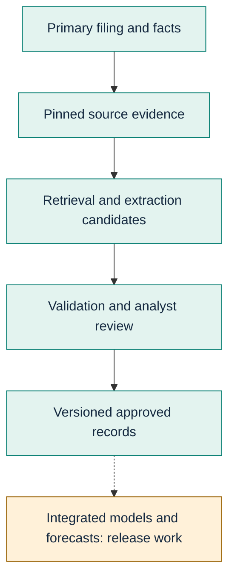
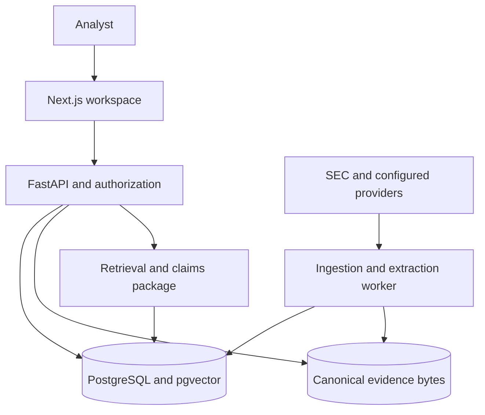

# Financial Evidence Lab executive system architecture

**Decision brief for CEO and CFO**

**Code baseline:** [`437ce55`](https://github.com/wilsonhj/financial-evidence-lab/commit/437ce558b9b63a54e4887c9e4226d5f528422629)

**Reviewed:** 22 September 2026

**Classification:** pre-release design and readiness assessment; not a production assurance opinion

## Decision in one minute

Financial Evidence Lab has built a credible technical foundation for research that can be traced back to source filings. The system separates source material, retrieval, structured extraction, analyst decisions, and immutable records. That architecture is valuable because a research conclusion can retain the document version, source span, cutoff, validation outcome, and subsequent corrections. It does **not** yet prove faster analyst work, lower total cost, forecast accuracy, public multi-user privacy, or commercial readiness.

The immediate management decision is to fund and sequence evidence for a safe release: request-scoped identity and private workspaces, user-owned model credentials with durable admission and accounting, hosted end-to-end proof, reference-load performance, and adjudicated live quality evaluation. Current public web business routes deliberately refuse requests until the session boundary exists. This is a safety feature, not a launch-ready application. [Deployment ADR](https://github.com/wilsonhj/financial-evidence-lab/blob/437ce558b9b63a54e4887c9e4226d5f528422629/docs/decisions/ADR-0027-deployment-modes.md), [current implementation checkpoint](https://github.com/wilsonhj/financial-evidence-lab/blob/437ce558b9b63a54e4887c9e4226d5f528422629/docs/handoff/STATUS.md).

## What the platform is building

The product aims to turn primary-source corporate information into defensible research. Analysts ingest and inspect filings, retrieve point-in-time evidence, evaluate claims, review structured financial proposals, and ultimately use approved evidence in models and forecasts. The full source-to-forecast workflow is the *target*, not the current product. [Canonical product specification](https://github.com/wilsonhj/financial-evidence-lab/blob/437ce558b9b63a54e4887c9e4226d5f528422629/specs/001-financial-evidence-lab/spec.md), [task ledger](https://github.com/wilsonhj/financial-evidence-lab/blob/437ce558b9b63a54e4887c9e4226d5f528422629/specs/001-financial-evidence-lab/tasks.md).

The solid path describes implemented foundations and review capabilities, not completed live acceptance. The dashed path highlights a missing integrated product. A calculation-engine package exists today, including typed decimals, formula evaluation, and scenarios; it must not be mistaken for a complete analyst-facing model or forecast product. [Calculation engine](https://github.com/wilsonhj/financial-evidence-lab/tree/437ce558b9b63a54e4887c9e4226d5f528422629/packages/calculation-engine), [model and forecast storage decision](https://github.com/wilsonhj/financial-evidence-lab/blob/437ce558b9b63a54e4887c9e4226d5f528422629/docs/decisions/ADR-0023-model-and-forecast-storage-boundaries.md).

## Current architecture at a glance

The Next.js workspace hosts the reader, search observability and review experiences. FastAPI owns identity, authorization, contracts, and request-scoped data access. A separate Python worker consumes durable database jobs and performs filing ingestion and extraction. PostgreSQL with pgvector holds metadata, private analysis, versions, jobs, and traces. Canonical evidence bytes live outside those metadata rows and must be available to both reader API and worker in the deployed topology. The existing real storage provider uses a local directory; a future shared storage solution is not yet certified simply because the target architecture names one. [System overview](overview.md), [storage implementation](https://github.com/wilsonhj/financial-evidence-lab/blob/437ce558b9b63a54e4887c9e4226d5f528422629/workers/src/fel_workers/storage.py).

This is a **logical component view**, not an assertion of deployed service topology. Workers claim jobs from the database; the API does not synchronously invoke them. External model adapters are excluded from the guaranteed runtime path: explicit-key embedding and generation adapters exist, but public credential custody and live provider promotion are separate gates. [Provider adapters](https://github.com/wilsonhj/financial-evidence-lab/tree/437ce558b9b63a54e4887c9e4226d5f528422629/packages/providers).

## Confidence and what it costs

| Executive question | Existing design mechanism | Evidence still required |
| --- | --- | --- |
| Can a number be defended? | Publication cutoff, pinned corpus/document versions, source offsets and hashes, validation, recorded review history | Live corpus and human-adjudicated numeric/citation quality on the frozen benchmark |
| Is one customer's work private? | Database membership and tenant row-level security for organization-owned analysis | Request-scoped public web sessions, hosted two-user isolation, private cache/CSRF controls |
| Are AI costs bounded? | Per-run extraction call, token, cost and wall-clock ceilings | User credential ownership, pre-call billable admission, durable accounting, operations budgets |
| Can an analyst correct a result? | Review API and append-only approved-record versions | Original #61 reference-load performance acceptance and end-to-end operating evidence |
| Can management depend on a forecast? | Decimal calculation primitives exist | Integrated model storage/UI, backtests, forecast release thresholds and explanation trail |

The technical mechanisms are not certifications. These are release questions, not a claim that the project has failed at them. The [constitution](https://github.com/wilsonhj/financial-evidence-lab/blob/437ce558b9b63a54e4887c9e4226d5f528422629/.specify/memory/constitution.md) and [numeric gates](https://github.com/wilsonhj/financial-evidence-lab/blob/437ce558b9b63a54e4887c9e4226d5f528422629/specs/001-financial-evidence-lab/spec.md#196-release-gates) explicitly block release when unsupported answers, numeric accuracy, temporal validity or other critical thresholds fail.

## Financial measurement without imaginary ROI

The economic objective is not merely cheaper inference. Customer-paid model usage may avoid owner-funded model bills, but does not remove hosting, support, storage, security, review labor or failed-run costs. Measure an approved cohort and accounting window before committing to margin claims.

**Cost per approved record** = (infrastructure + provider charges + failed/retried attempts + attributable review labor + support allocation) ÷ approved records. When the denominator is zero, report the cost and an undefined unit cost. Separate customer-paid inference from owner operating cost and reconcile their sum; do not double-count a customer pass-through as product revenue. Track review minutes per accepted record, evidence-citation validity, rejection rate, and 30-day rework. These are recommended measures, not measured results.

## Three investment gates

1. **Authorize the trust boundary.** Implement per-user sessions and workspace bootstrap; bind encrypted user-owned credentials to the actor; reserve and account for each billable action before provider calls. Require a hosted, two-user isolation demonstration. Parent scope: [#324](https://github.com/wilsonhj/financial-evidence-lab/issues/324).
2. **Demand reproducible operating evidence.** Run the unchanged #61 25-active-user load profile on an appropriate target and retain all samples. Verify hosted worker → database → API → web reader evidence against exact deployed revisions. The last pinned handoff says hosted proof was missing, and [#108](https://github.com/wilsonhj/financial-evidence-lab/issues/108) remains open: a keyword closure on 16 September was reversed on 26 September because no hosted run had occurred. [#61](https://github.com/wilsonhj/financial-evidence-lab/issues/61), [handoff](https://github.com/wilsonhj/financial-evidence-lab/blob/437ce558b9b63a54e4887c9e4226d5f528422629/docs/handoff/STATUS.md).
3. **Fund differentiated quality and product integration.** Validate live corpus/provider paths, complete human-adjudicated calibration, then integrate approved records with model/scenario storage, forecast workflows and exports. Do not make downstream release promises from a mock-first green CI run. [Product plan](https://github.com/wilsonhj/financial-evidence-lab/blob/437ce558b9b63a54e4887c9e4226d5f528422629/specs/001-financial-evidence-lab/plan.md).

The decision is to approve evidence-producing work in stages, with each stage reporting cost, quality, safety and user value against the same frozen criteria. No budget, timeline or commercial return is inferred from this design brief.

---

For an executive board, import the accompanying [vector blueprint](./assets/executive-blueprint.svg) into Miro. Miro treats SVG as a single image, not native editable shapes; add board notes separately. Free-team boards are visible to team members and the free tier allows three active boards ([Miro Free plan](https://help.miro.com/hc/en-us/articles/360017730373-Free-Plan), [supported formats](https://help.miro.com/hc/en-us/articles/360017731613-Supported-file-formats)). The technical review companions are the [architecture overview](./overview.md) and [system design](./system-design.md). The source code was inspected directly. [DeepWiki Open](https://github.com/AsyncFuncAI/deepwiki-open) supplied the navigable-wiki/diagram concept; it was not run against this repository and no generated assertions were accepted without source inspection.
