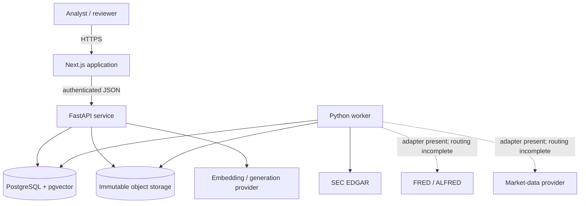
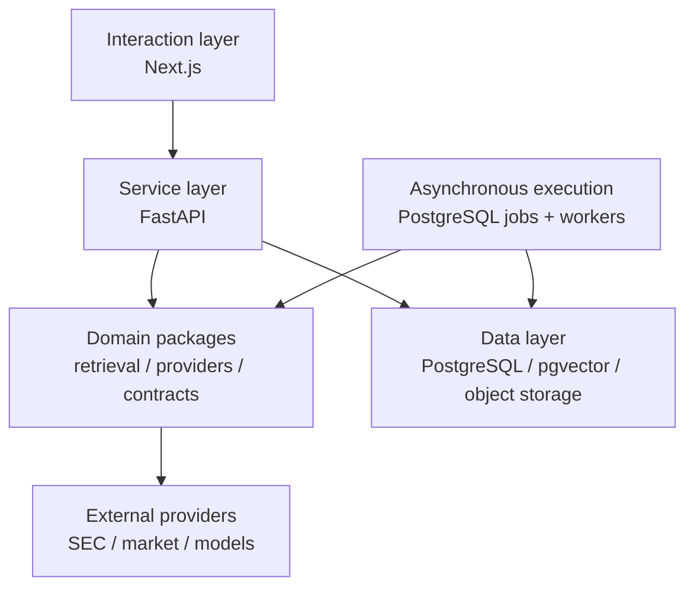
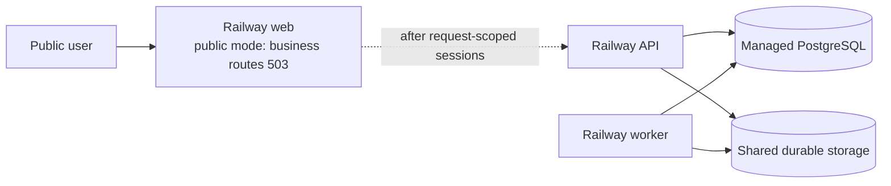

# Architecture overview

Relevant source files

- [apps/api/app/main.py](../../apps/api/app/main.py) — API entrypoint and router registration
- [apps/api/app/db.py](../../apps/api/app/db.py) — tenant-scoped transactions and the `fel_app` role switch
- [workers/src/fel_workers/consumer.py](../../workers/src/fel_workers/consumer.py) — worker claim and dispatch loop
- [workers/src/fel_workers/extraction/budget.py](../../workers/src/fel_workers/extraction/budget.py) — extraction hard budget caps
- [packages/retrieval/fel_retrieval/](../../packages/retrieval/fel_retrieval/) — chunking, lanes, fusion, traces
- [packages/providers/fel_providers/](../../packages/providers/fel_providers/) — provider protocols and deterministic mocks
- [packages/contracts/](../../packages/contracts/) — versioned JSON Schemas and OpenAPI descriptions
- [db/migrations/](../../db/migrations/) — append-only schema migrations
- [infra/railway/](../../infra/railway/) — Railway API, worker and web service definitions

Source references verified against commit `437ce55`.

This document describes the architecture that is present on `main`, not only
the target product. Planned components are labeled so a new contributor can
tell which paths are safe to run, extend, or depend on. For a leadership
readout of the same architecture, see the
[executive architecture brief](./executive-brief.md).

## Product boundary

Financial Evidence Lab turns public-company source material into auditable
research:

1. ingest and version primary-source documents and facts;
2. retrieve evidence under a point-in-time cutoff;
3. decompose answers into claims and citations;
4. extract structured financial concepts;
5. build models and forecasts with traceable calculation lineage.

Steps 1–3 are implemented in mock-first form. Step 4 has merged contracts,
database foundations, a bounded durable extraction runtime — an ontology
package and a checkpointed worker FSM (`61058e4`, PR #145) — and review,
correction and approved-version history APIs over migration `0011`, described
in [`system-design.md`](./system-design.md#extraction-boundary). Step 5 has a
standalone Decimal calculation engine (`packages/calculation-engine`); the
model composer, forecasting and release workflows that would use it are
roadmap work.

## System context

The arrows show allowed logical dependencies, not every call. PostgreSQL is
the coordination and metadata backbone: the `jobs` table is the API/worker
channel, extraction executes inside the worker, and retrieval executes in the
API process — neither is a separately deployed service. Immutable filing
bodies live behind storage object keys; structured provenance, spans, facts,
jobs, retrieval indexes, runs, and audit records live in PostgreSQL.

## Containers and responsibilities

The last column records what each boundary does **not** establish, so that a
present module is not mistaken for a passed acceptance gate.

| Container/package                              | Responsibility                                                                                                 | Current maturity / non-claim                                                                                                               |
| ---------------------------------------------- | -------------------------------------------------------------------------------------------------------------- | ------------------------------------------------------------------------------------------------------------------------------------------ |
| `apps/web`                                     | Evidence Reader, Search Observatory, extraction review, run comparison, server-side API integration            | Implemented in fixture and HTTP modes; public deployments refuse business routes (HTTP 503) until request-scoped sessions exist (ADR-0027) |
| `apps/api`                                     | Token verification, membership, RLS transaction setup, workspaces, corpus/reader, retrieval, extraction review | Mock and Supabase JWKS verifiers implemented (ADR-0025); a verified API token is not a per-user web session                                |
| `workers`                                      | Durable job claiming, SEC discovery/fetch/company-facts ingestion, extraction runtime, leases and retries      | Implemented for SEC and extraction paths; not a request handler                                                                            |
| `packages/retrieval`                           | Chunking, lane retrieval, deterministic plan/fusion, traces, claims, replay                                    | Implemented, mock-provider first; mock runs do not prove live provider quality                                                             |
| `packages/providers`                           | Stable external-provider protocols, deterministic mocks, explicit-key adapters                                 | Interfaces/mocks implemented; an adapter is not an authorized or promoted runtime provider                                                 |
| `packages/contracts`                           | Versioned JSON Schemas, OpenAPI descriptions, generated TypeScript types                                       | Implemented; OpenAPI and package version `0.9.0`                                                                                           |
| `db/migrations`                                | Tenant, corpus, retrieval, extraction, review, queue, worker-role, and RLS schema                              | Implemented through migration `0011`; a table is not a hosted service                                                                      |
| `evals`, `packages/retrieval-evals`            | Cross-stack fixtures, graders, and retrieval benchmarks                                                        | Synthetic gates implemented; live gates open                                                                                               |
| `packages/ontology`                            | saas-metrics/v1 ontology (9 families / 14 metrics), comparability keys, unit comparison vocabulary (ADR-0019)  | Implemented                                                                                                                                |
| Extraction runtime (`workers/.../extraction`)  | Durable worker FSM: typed roles, normalization, validators, budget enforcement, atomic persistence             | Implemented (`61058e4`, PR #145); every proposal requires human review                                                                     |
| `packages/calculation-engine`                  | Decimal values, closed unit algebra, fiscal periods, formula ASTs, model graph, snapshots, scenarios           | Implemented as a library with property tests; no application or worker imports it yet                                                      |
| Model composer, forecast, backtest, release UI | Integrated model and forecast product                                                                          | Planned                                                                                                                                    |

## Architectural layers

The layers are intentionally boring:

- UI code does not query PostgreSQL directly.
- API requests enter a tenant-scoped transaction before application queries.
- Workers claim jobs without holding a transaction during provider calls.
- Provider SDKs stay behind repository-owned interfaces.
- Contracts are versioned and generated; application packages consume them
  rather than maintaining private mirrors.

## Data ownership and migration groups

Migrations are append-only:

| Migration                                 | Major ownership                                                                               |
| ----------------------------------------- | --------------------------------------------------------------------------------------------- |
| `0001_platform_core.sql`                  | organizations, membership, workspaces, audit, usage, PostgreSQL jobs                          |
| `0002_corpus_core.sql`                    | entities, documents, versions, sections, spans, facts, corpus versions, quarantine, ingestion |
| `0003_retrieval_core.sql`                 | retrieval indexes/items, queries, runs, events, claims, feedback                              |
| `0004_extraction_core.sql`                | extraction runs, proposals, evidence, conflicts, review/correction foundations                |
| `0005_retrieval_query_guard_role_fix.sql` | retrieval query guard/RLS role correction                                                     |
| `0006_extraction_step_output.sql`         | `extraction_run_steps.output` checkpoint column (ADR-0011, #157)                              |
| `0007_jobs_hardening.sql`                 | job retry scheduling, reaper index, cancellation (#189)                                       |
| `0008_worker_role.sql`                    | least-privilege `fel_worker` role for the job path (#190)                                     |
| `0009_platform_fk_hygiene.sql`            | organization foreign keys on audit, usage and job rows (#197)                                 |
| `0010_api_read_indexes.sql`               | bounded-pagination read indexes (ADR-0021, #191)                                              |
| `0011_extraction_review.sql`              | run cancellation requests, review validation context, conflict occurrences (ADR-0024)         |

Application code must never modify an old migration to repair deployed state;
use a new migration and the repository's contract-change process.

## Trust boundaries

### Browser to Next.js

The browser receives rendered data and client-safe state. API bearer tokens and
provider credentials stay in server-only environment variables. The web
runtime configuration module deliberately imports Node-only APIs so accidental
client imports fail at build time.

### Next.js to FastAPI

The web deployment mode is explicit (ADR-0027,
`apps/web/src/lib/deployment-mode.ts`): `public`, `fixture`, `reader-smoke`,
or `synthetic-http`. A missing mode means `public`, and public business routes
return HTTP 503 without calling the API; health stays reachable. No shared
deployment bearer may stand in for a public web user's identity. The
`reader-smoke` and `synthetic-http` modes send a mock-identity request to
FastAPI only with matching target and storage markers. The HTTP adapter
(`apps/web/src/lib/data/http-source.ts`) preserves typed authentication,
forbidden, conflict, invalid-scope, integrity, and outage states.

### FastAPI to PostgreSQL

The API verifies identity, looks up membership, begins a transaction, applies
request claims, and switches to `fel_app`. `FEL_AUTH_MODE` selects `mock` or
`supabase`; `apps/api/app/deployment.py` refuses business authentication with
`AUTH_UNAVAILABLE` unless the mode is consistent with the deployment mode
(public requires `supabase`). RLS is the final tenant boundary.
Evidence-corpus tables are shared/read-only to the application by design;
analysis/workspace data is organization-scoped.

### Worker to PostgreSQL and external providers

Workers enter the `fel_worker` role (migration `0008`, ADR-0020) through
`FEL_WORKER_DB_ROLE`, pinned in the Railway worker start command. They use
repository-owned provider interfaces, explicit modes, timeouts, leases, and
idempotency keys. Live SEC execution requires a fair-access user agent and
durable storage. Provider output is untrusted input and must pass schema,
provenance, and financial validation before promotion.

## Deployment topology

Railway config-as-code defines web, API, and worker services
(`infra/railway/{web,api,worker}.json`). API and worker share PostgreSQL and
must share durable evidence storage. Sentry initializes only when
`FEL_SENTRY_DSN` is set. The only real storage provider is
`LocalDirStorageProvider` (`workers/src/fel_workers/storage.py`); there is no
hosted object-storage adapter, and the hosted worker-to-reader smoke (#108)
has not run against a dedicated target.

The dashed edge is not an authorized live user flow today. Do not deploy API
and worker with process-local storage paths that point to different disks:
citations will resolve in the database but canonical content will be
unreadable.

The accepted stack (ADR-0002) deliberately avoids a separate queue, vector
store, or streaming transport until a measured
[revisit trigger](../decisions/ADR-0002-mvp-stack.md#revisit-triggers) fires:
sustained queue load above 100 jobs/sec, more than 20 million vectors or
recall-driven `ef_search` inflation, or streamed runs longer than 15 minutes.
These are decision triggers, not observed bottlenecks.

## Architecture invariants

The following are compatibility requirements, not implementation preferences:

- **Temporal correctness:** every source carries a publication/availability
  time and every read honors an effective cutoff.
- **Determinism:** persisted ranks, scores, decimals, versions, and ordering
  rules make a run reproducible.
- **Evidence integrity:** offsets are document-global, text slices are
  hash-verified, and cross-version evidence is rejected.
- **Tenant isolation:** organization-owned data is protected by RLS under a
  non-owner application role.
- **Immutable lineage:** published corpus/index versions and accepted results
  are superseded, not overwritten in place.
- **Fail closed:** incomplete configuration, unknown modes, corrupt evidence,
  and unsupported live providers stop execution explicitly.
- **Bounded cost:** operations reserve/check budgets and record usage. The M3
  extraction runtime enforces calls/tokens/cost/wall-clock hard caps
  (`extraction/budget.py`), pre-call and post-call, carried across queue
  retries of the same run.

## Sources of truth

Use each artifact for its intended purpose:

1. [`constitution.md`](../../.specify/memory/constitution.md) — non-negotiable
   product and engineering principles.
2. [`spec.md`](../../specs/001-financial-evidence-lab/spec.md) — canonical
   product requirements.
3. [`plan.md`](../../specs/001-financial-evidence-lab/plan.md) and
   [`tasks.md`](../../specs/001-financial-evidence-lab/tasks.md) — intended
   implementation sequence and gates.
4. [`docs/decisions`](../decisions/) — accepted and proposed architecture
   decisions.
5. [`packages/contracts`](../../packages/contracts/) and
   [`db/migrations`](../../db/migrations/) — executable compatibility surface.
6. GitHub issues, pull requests, and current `main` — live delivery state.
7. [`docs/handoff`](../handoff/) — coordination snapshots; useful, but they can
   lag recent merges and must be reconciled before dispatch.
8. [`docs/runbooks`](../runbooks/) — operator runbooks for durable subsystems
   (for example [`extraction-worker.md`](../runbooks/extraction-worker.md)),
   plus in-package `OPERATOR.md` files such as
   [`workers/src/fel_workers/extraction/OPERATOR.md`](../../workers/src/fel_workers/extraction/OPERATOR.md).

When code changes, update these diagrams together with the invariants and
acceptance evidence they describe. For lower-level behavior and current gaps,
read [`system-design.md`](./system-design.md).

## Related pages

- [Executive architecture brief](executive-brief.md)
- [System design](system-design.md)
- [API](../../apps/api/README.md)
- [Workers](../../workers/README.md)
- [Ontology](../../packages/ontology/README.md)
- [Local development](../development/local.md)
- [Testing guide](../development/testing.md)
- [Extraction worker runbook](../runbooks/extraction-worker.md)
- [Architecture decisions](../decisions/)
