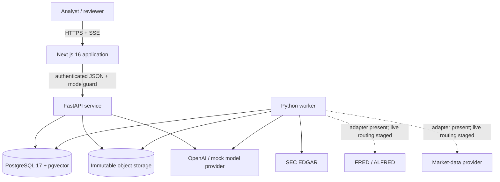
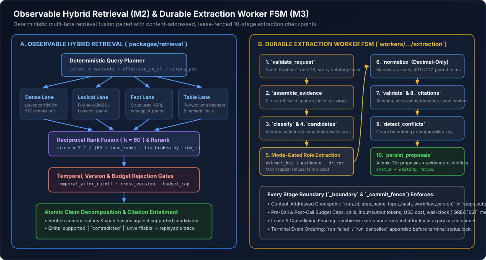
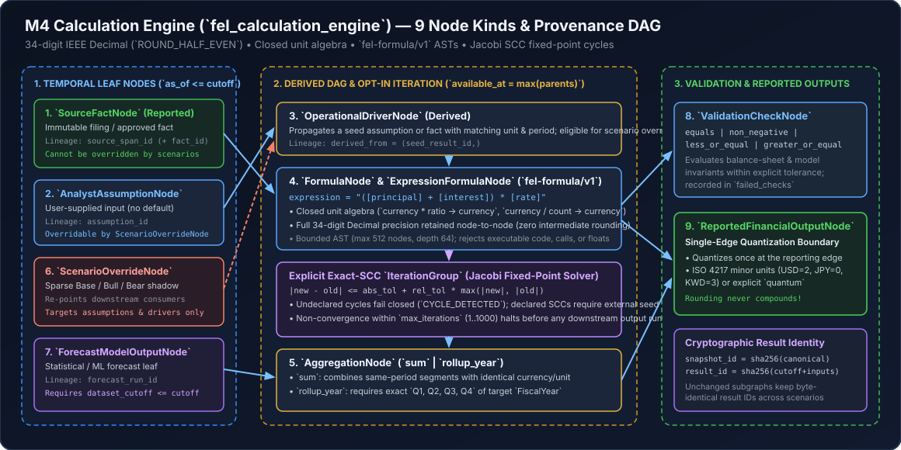

# Architecture overview

This document describes the architecture that is present on `main`, alongside
its explicit boundaries and remaining production cutover gates.

## Product boundary

Financial Evidence Lab turns public-company source material into auditable,
interactive research:

1. **Ingest and version** primary-source SEC filings, sections, character spans,
   and XBRL facts (`M1`);
2. **Retrieve evidence** across four cutoff-safe lanes (dense, lexical, fact,
   table) with deterministic Reciprocal Rank Fusion (`k=60`) (`M2`);
3. **Decompose answers** into atomic claims and verify citation entailment and
   numeric fidelity (`M2`);
4. **Extract structured financial concepts** via a 10-stage durable worker FSM,
   validate accounting identities, and route proposals through an atomic human
   conflict-review queue (`M3`);
5. **Build financial models and scenarios** using a 34-digit Decimal calculation
   DAG with four-way provenance (`reported`, `assumption`, `derived`, `forecast`),
   formula ASTs, and Jacobi fixed-point iteration (`M4` / `M5`).

## System context

PostgreSQL is the coordination and metadata backbone. Immutable filing bodies
live behind content-addressed storage object keys; structured provenance, spans,
facts, jobs, retrieval indexes, runs, extraction proposals/conflicts, approved
versions, and audit records live in PostgreSQL.

## Containers and responsibilities

| Container / package | Responsibility | Current maturity |
| :--- | :--- | :--- |
| `apps/web` | Evidence Reader (`/`), Earnings Update Desk (`/desk` with 3D/2D lineage & scenario visuals), Search Observatory (`/observatory`), Extraction Review Queue (`/extractions`), run comparison, and deployment-mode guard | Implemented in fixture and dedicated HTTP modes; public session custody pending (#324) |
| `apps/api` | Authentication boundary (`supabase_auth.py` + `auth.py`), RLS transaction setup (`fel_app`), workspaces, composite reader, retrieval/claims, and batched extraction review/SSE APIs | Implemented; per-org rate limits and query budgets active |
| `workers` | Durable job claiming (`SKIP LOCKED` + lease heartbeat + `fel_worker` RLS role), SEC discovery/fetch/company-facts ingestion, and 10-stage extraction FSM | Implemented for SEC ingestion and extraction queues |
| `packages/retrieval` | Chunking, 4-lane retrieval, deterministic query planner/RRF (`k=60`), traces, non-identity claim decomposition/verification, byte-stable replay | Implemented |
| `packages/providers` | Stable external-provider protocols, deterministic mocks, explicit-key OpenAI structured output & 512-dim embeddings, offline BYOK credential cipher | Implemented; runtime BYOK session wiring pending (#324) |
| `packages/contracts` | Versioned JSON Schemas, OpenAPI 3.1 specs (v0.6.0), AJV guards, generated TypeScript types | Implemented through M3 review & API hardening |
| `packages/ontology` | `saas-metrics/v1` ontology (9 families / 14 metrics), enum/qualifier validation, deterministic comparability keys | Implemented |
| `packages/calculation-engine` | 34-digit Decimal calculation DAG, 9 node kinds, closed unit algebra, `fel-formula/v1` ASTs, Jacobi SCC iteration, Base/Bull/Bear scenarios, 5,000-node benchmark (~43 ms) | Implemented in Python (`fel_calculation_engine`); DB persistence tables pending (#197) |
| `db/migrations` | Tenant, corpus, retrieval, extraction, review, worker-RLS, and index migrations + checksummed applier (`scripts/db/migrate.py`) | Implemented through migration `0011` |
| `evals`, `packages/retrieval-evals` | Cross-stack fixtures, SEC transport smoke, 65-question retrieval gate, extraction cross-stack harness, deterministic Markdown/SVG corpus QA renderer | Implemented; live credentialed runs gated on cutover (#177) |

## Deep-dive subsystem diagrams

### Observable Hybrid Retrieval (M2) & Durable Extraction FSM (M3)

### Deterministic Calculation DAG & Four-Way Provenance (M4)

## Data ownership and migration groups

Migrations are append-only and applied via the checksummed ledger in
`scripts/db/migrate.py` (ADR-0014):

| Migration | Major ownership |
| :--- | :--- |
| `0001_platform_core.sql` | organizations, memberships, workspaces, audit events, usage events, PostgreSQL jobs |
| `0002_corpus_core.sql` | entities, documents, document versions, sections, spans, facts, corpus versions, quarantine |
| `0003_retrieval_core.sql` | retrieval indexes/items (`vector(512)`), queries, runs, events, claims, citations, feedback |
| `0004_extraction_core.sql` | extraction runs, steps, events, proposals, evidence edges, conflicts, transition guards |
| `0005_retrieval_query_guard_role_fix.sql` | retrieval query guard / RLS role correction (`fel_app`) |
| `0006_extraction_step_output.sql` | `extraction_run_steps.output` column for durable stage checkpoints (ADR-0011) |
| `0007_jobs_hardening.sql` | poison-job dead-lettering, retry backoff, reaper index, `cancel_requested_at` |
| `0008_worker_role.sql` | least-privilege `fel_worker` role with per-table RLS policies |
| `0009_platform_fk_hygiene.sql` | `org_id` foreign keys on `audit_events`, `usage_events`, and `jobs` |
| `0010_api_read_indexes.sql` | composite pagination and read-path indexes for bounded API queries |
| `0011_extraction_review.sql` | atomic extraction review receipts, approved extraction records/versions, and conflict resolution |

Application code must never modify an existing migration to repair deployed
state; always add a new migration under the `contract-change` process.

## Trust boundaries

### Browser to Next.js (`apps/web`)

The browser receives rendered HTML/RSC payloads and client-safe state. API
bearer tokens and provider credentials stay in server-only environment
variables. The web runtime configuration module imports Node-only APIs so
accidental client imports fail at build time, and the deployment guard
(`apps/web/src/lib/deployment-mode.ts`) refuses to serve business routes with a
shared bearer token in `public` mode.

### Next.js to FastAPI (`apps/api`)

Dedicated HTTP modes (`synthetic-http`, `reader-smoke`) send authenticated
requests to FastAPI. The web adapter preserves typed not-found, validation,
authentication, integrity-error, and outage states.

### FastAPI to PostgreSQL

The API verifies identity (via Supabase JWKS in `supabase_auth.py` or mock
tokens in explicit synthetic modes), resolves active membership in PostgreSQL,
begins a transaction, sets transaction-local request claims, and executes
application queries under `SET LOCAL ROLE fel_app`. Row-Level Security (RLS) is
the final tenant boundary.

### Worker to External Providers

Workers claim jobs with short transactions (`FOR UPDATE SKIP LOCKED`), renew
leases via heartbeats, and call external providers outside database
transactions. Provider outputs are treated as untrusted input and must pass JSON
Schema validation, SHA-256 citation verification, and Decimal accounting checks
before persistence.

## Sources of truth

1. [`constitution.md`](../../.specify/memory/constitution.md) — non-negotiable product and engineering principles.
2. [`spec.md`](../../specs/001-financial-evidence-lab/spec.md) — canonical product requirements.
3. [`plan.md`](../../specs/001-financial-evidence-lab/plan.md) and [`tasks.md`](../../specs/001-financial-evidence-lab/tasks.md) — canonical implementation sequence and task ledger.
4. [`docs/decisions`](../decisions/) — Architecture Decision Records (`ADR-0001` through `ADR-0028`).
5. [`packages/contracts`](../../packages/contracts/) and [`db/migrations`](../../db/migrations/) — executable compatibility surface.
6. [`system-design.md`](./system-design.md) — deep-dive runtime behavior, invariants, and open release gates.
7. [`visualization-roadmap.md`](./visualization-roadmap.md) — 2D/3D interactive graphics and gamified UX architecture.
