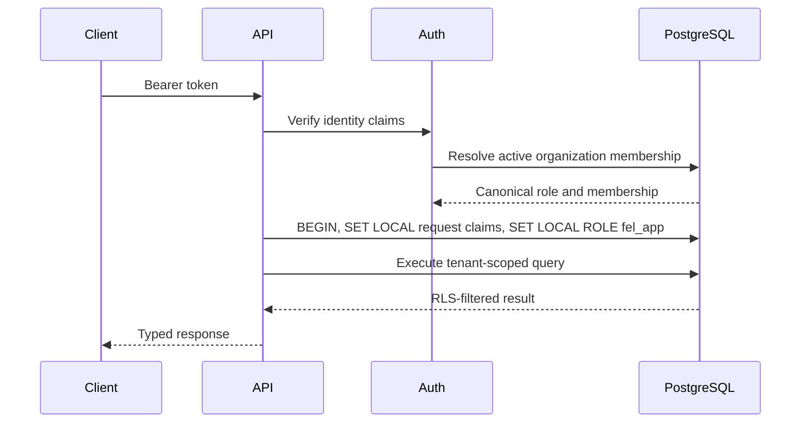
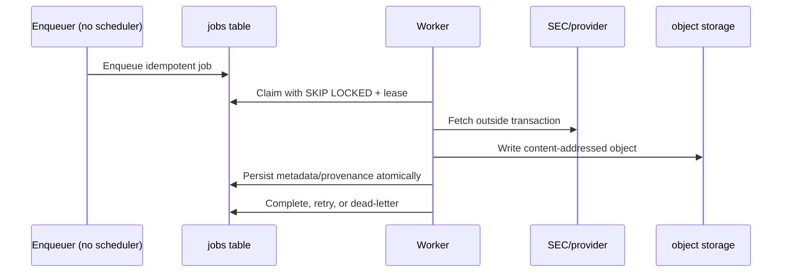
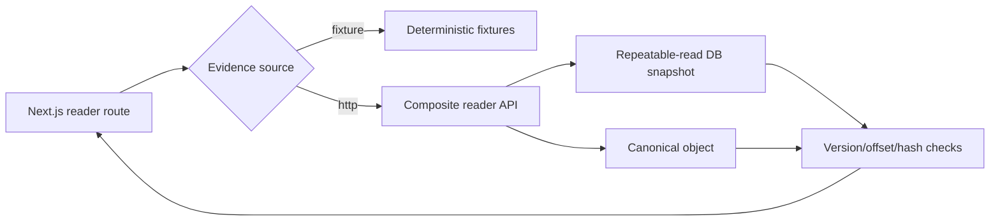
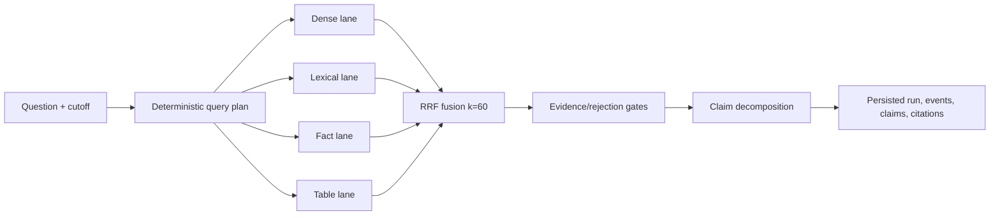

# System design

<details>
<summary>Relevant source files</summary>

- [apps/api/app/dependencies.py](../../apps/api/app/dependencies.py) — verifier selection and membership lookup
- [apps/api/app/db.py](../../apps/api/app/db.py) — transaction-local request claims and `SET LOCAL ROLE fel_app`
- [apps/api/app/reader.py](../../apps/api/app/reader.py) — composite reader endpoint and cutoff predicates
- [workers/src/fel_workers/queue.py](../../workers/src/fel_workers/queue.py) — `SKIP LOCKED` job queue, leases and reaping
- [packages/retrieval/fel_retrieval/fusion.py](../../packages/retrieval/fel_retrieval/fusion.py) — lane fusion and RRF
- [packages/ontology/fel_ontology/](../../packages/ontology/fel_ontology/) — saas-metrics/v1 ontology
- [workers/src/fel_workers/extraction/workflow.py](../../workers/src/fel_workers/extraction/workflow.py) — durable extraction workflow FSM
- [workers/src/fel_workers/extraction/budget.py](../../workers/src/fel_workers/extraction/budget.py) — extraction budget enforcement
- [workers/src/fel_workers/extraction/normalize/](../../workers/src/fel_workers/extraction/normalize/) — payload normalization
- [workers/src/fel_workers/extraction/validate/](../../workers/src/fel_workers/extraction/validate/) — deterministic validators
- [workers/src/fel_workers/redact.py](../../workers/src/fel_workers/redact.py) — job error redaction
- [db/migrations/0004_extraction_core.sql](../../db/migrations/0004_extraction_core.sql) — extraction tables, RLS and transition guards

</details>

Source references verified against commit `f4b1197`.

This guide explains how Financial Evidence Lab preserves tenant, temporal, and
evidence correctness across ingestion, retrieval, and review. It is aimed at a
developer changing runtime behavior, schemas, or service boundaries.

## Contents

- [Design goals](#design-goals)
- [Identity, tenancy, and authorization](#identity-tenancy-and-authorization)
- [Temporal model](#temporal-model)
- [Ingestion and evidence storage](#ingestion-and-evidence-storage)
- [Reader request path](#reader-request-path)
- [Retrieval pipeline](#retrieval-pipeline)
- [Extraction boundary](#extraction-boundary)
- [Failure, concurrency, and idempotency semantics](#failure-concurrency-and-idempotency-semantics)
- [Cost and observability](#cost-and-observability)
- [Deployment modes](#deployment-modes)
- [Known gaps and open decisions](#known-gaps-and-open-decisions)
- [Change rules](#change-rules)
- [Related pages](#related-pages)

## Design goals

The system is optimized for:

- a defensible answer over a merely fluent answer;
- reproducible point-in-time research;
- immutable evidence and calculation lineage;
- transparent retrieval and validation decisions;
- deterministic mock execution in CI;
- explicit provider and deployment boundaries;
- safe parallel development through versioned contracts.

It is not currently optimized for:

- anonymous public access;
- low-latency streaming generation at scale;
- arbitrary document formats beyond the supported financial corpus;
- automatic acceptance of model output;
- completed financial modeling or forecasting workflows.

## Identity, tenancy, and authorization

An authenticated principal has a user identity, but authorization comes from
the active database membership.



Important properties:

- The role asserted by a mock token is not authoritative.
- API database connections do not execute application queries as a table owner.
- Request claims are transaction-local so pooled connections cannot leak
  tenant context.
- Organization-owned workspace, query, run, feedback, extraction, and review
  records are RLS-scoped.
- The source corpus is shared and application-read-only by design. Workers
  curate it; organizations create private analysis over it.

`FEL_AUTH_MODE` selects one of two verifiers (`apps/api/app/dependencies.py`):

- `mock` accepts unsigned mock tokens and is permitted only in the explicit
  `reader-smoke` and `synthetic-http` deployment modes, each of which must also
  match a target marker in its storage directory.
- `supabase` (`apps/api/app/supabase_auth.py`, ADR-0025) verifies ES256/RS256
  access tokens against an exact HTTPS issuer and audience through a bounded,
  cooldown-limited JWKS cache. It maps only the UUID `sub` and trusted
  `app_metadata.org_id`; the role still comes from database membership.

`apps/api/app/deployment.py` (ADR-0027) refuses business authentication with
`AUTH_UNAVAILABLE` (503) for any other combination. A missing deployment mode
means `public`, which requires `supabase`.

The sequence above is the API path. It is **not** yet a per-user web path:
public web business routes return 503 until request-scoped sessions exist, and
a shared server token must never be configured in a public Next.js deployment
to imitate a user. That is a safe unavailable state, not completed signup
(#324, [`STATUS.md`](../handoff/STATUS.md)).

## Temporal model

Every research action resolves an **effective cutoff**. A valid source must be
known by that instant:

```text
published_at <= effective_as_of
```

`published_at` is the real column name — on `documents` (`db/migrations/0002_corpus_core.sql`)
and in every cutoff predicate (`apps/api/app/reader.py`). The only
`available_at` column is `jobs.available_at` (migration `0007`), a retry
schedule; the calculation engine's node `available_at` is an in-memory model
bound. Neither is a document cutoff column; grep for the name you see here.

The rule applies to both collection endpoints and direct reads. A user must not
be able to bypass a cutoff by guessing a document or version URL.

The composite reader accepts optional cutoff and corpus-version pins. It:

1. opens a read-only, repeatable-read transaction;
2. resolves the visible target and related documents under the cutoff;
3. selects one parsed document version deterministically;
4. loads sections, spans, and facts only from that selected version;
5. returns the effective cutoff and corpus version in the response.

Exact cutoff boundaries are inclusive. Future siblings, draft corpus versions,
quarantined versions, and cross-version evidence are excluded.

## Ingestion and evidence storage

### Job flow



No scheduler is implemented, and no deployed component enqueues ingestion
work. The evaluation harnesses are the only enqueuers outside tests:
`evals/harness/corpus_qa.py` enqueues root `sec_discovery` jobs, and the
`sec_discovery` handler then enqueues one `sec_filing_fetch` job per filing on
the queue it was claimed from (`fel_workers/ingestion/discovery.py`);
`evals/harness/reader_prod_smoke.py` enqueues `sec_filing_fetch` jobs directly
on its own `reader-smoke` queue. Nothing outside tests calls
`enqueue_company_facts`, so no company-facts job is enqueued in any runtime
path.

Workers keep claim transactions short. A lease heartbeat makes abandoned jobs
recoverable. Idempotency keys prevent repeated delivery from creating
duplicate logical work.

The deployed consumer currently dispatches SEC discovery, filing fetch, and
company-facts ingestion. FRED and market-data adapters exist, but their live
job routing is not complete.

### Document identity

Do not conflate these IDs:

- a **document** is a logical filing;
- a **document version** is one immutable parse/content version;
- a **corpus version** is an immutable set of approved document versions;
- a **retrieval index version** is built from exactly one published corpus
  version.

Canonical text is stored as an immutable object. PostgreSQL records its object
key, checksum, metadata, sections, spans, facts, and quarantine state.

### Coordinates and hashes

Persisted section and span offsets are canonical **document-global** character
offsets. UI-local highlighting derives:

```text
local_start = span.start_char - section.start_char
local_end   = span.end_char   - section.start_char
```

The derived slice must match the stored hash. A span outside its section, a
hash mismatch, or evidence from another selected version is an integrity
failure—not an empty result.

## Reader request path

The reader uses one authenticated composite endpoint rather than assembling a
page from independently versioned calls. This ensures sections, spans, facts,
corpus version, cutoff, and selected document version come from one snapshot.



HTTP and fixture modes are explicit. Production must never fall back to fixture
data. The web adapter (`apps/web/src/lib/data/http-source.ts`) classifies a 5xx
carrying `INTEGRITY_ERROR` as an integrity failure rather than generic
unavailability, and maps 401/403/409/413/422 to their own typed states. On
the API side, an unknown or draft corpus pin returns 404 with
`details.resource = "corpus_version"` (`apps/api/app/corpus.py::require_corpus`),
so it is distinguishable from a missing document.

## Retrieval pipeline

### Index construction

The item builder creates stable, provenance-rich retrieval items from published
corpus versions:

- text chunks with deterministic boundaries;
- structured financial facts;
- table-derived items;
- vector representations limited by the frozen 512-dimension contract.

Publishing an index pins its corpus version, provider/model identity, chunking
configuration, and build metadata. Published inputs are immutable so replay
does not drift.

Index build and publish (`fel_retrieval/index_build.py`: `build_index`,
`publish_index_version`) have no runtime caller. The only caller outside tests
is the offline retrieval gate (`evals/harness/retrieval_gate.py`); neither the
API nor the worker builds or publishes an index.

### Query execution



The trace records lane contributions, ranks, scores, decisions, versions, and
rejection reasons. Reruns consume immutable inputs; feedback is tied to a
specific run and candidate.

The current API executes the pipeline before returning its nominal `202`
response. Runs are therefore synchronous-terminal today. The event endpoint
replays committed events; it is not a live asynchronous SSE producer.
Extraction runs differ: they execute as worker jobs, and
`apps/api/app/extraction/routes_events.py` streams their committed events live
over SSE (issue #135, PR #288).

### Current provider limitation

Only deterministic mock embedding and structured-generation providers are
wired into the production path. A live provider pin fails closed. The
65-question release gate must select and pin real providers at the required
dimension, run over a checksum-pinned corpus, and report retrieval/claim
metrics. The current mock claim decomposition also reuses evidence identity,
so it is not evidence of live numerical verification quality.

## Extraction boundary

On `main`, M3 ships a complete bounded extraction subsystem: v0.4 JSON
Schema/OpenAPI contracts, extraction/provider protocols and deterministic
mocks, migration `0004`'s tables/RLS/transition guards, a first-party ontology
package, and a durable, checkpointed worker FSM. The runtime merged as
`61058e4` (PR #145, closing #60); downstream code may assume it is present on
`main`. Later migrations moved the checkpoint onto
`extraction_run_steps.output` (`0006`, ADR-0011) and added run cancellation
requests, review validation context, and conflict occurrences (`0011`,
ADR-0024). The API exposes run, step-history, event-replay, review-decision,
correction, and approved-version routes under `apps/api/app/extraction/`. The
web app reaches them through server-side proxies
(`apps/web/src/app/api/extraction/[...path]/route.ts` and
`.../runs/[runId]/events/route.ts`, which relays the SSE stream); in HTTP
mode they call FastAPI with the server-held bearer token and the configured
`FEL_WORKSPACE_ID`, never the browser's credentials. Its
genuine remaining gaps are tracked below under
[Known gaps and open decisions](#known-gaps-and-open-decisions), not treated
as unmerged.

Operational detail (queue name, payload shape, budget defaults, the
memory-store opt-in) lives in
[`docs/runbooks/extraction-worker.md`](../runbooks/extraction-worker.md) and
[`workers/src/fel_workers/extraction/OPERATOR.md`](../../workers/src/fel_workers/extraction/OPERATOR.md).
This section covers the architecture.

### Ontology (`packages/ontology`)

- `fel_ontology/models.py` declares frozen dataclasses — `MetricDef` (id,
  canonical name, family, `kind`, `value_type`, unit, `period_semantics`,
  scale handling, aliases, required qualifiers, comparability-key fields,
  derivation/review policy), `Family`, `OntologyDocument` — and the `Literal`
  vocabularies (`ValueType`, `PeriodSemantics`, `MetricKind`) those fields are
  drawn from.
- `fel_ontology/loader.py::load_saas_metrics` loads and structurally validates
  `data/saas-metrics.v1.json`: it requires exactly 9 families and the 14
  expected metric ids (`arr`, `mrr`, `nrr`, `grr`, `cust_total`,
  `cust_threshold`, `seats`, `bookings`, `billings`, `rpo`, `crpo`,
  `deferred_rev`, `sub_gm`, `svc_gm`), that family membership exactly
  partitions the metric set, and that every enum field is a real member of its
  `Literal` alias (checked via `typing.get_args`, not restated as a separate
  list) so the loader and the type can never silently drift apart. It returns
  a `content_hash` of the raw file, which is pinned into extraction run
  requests and folded into every role's rendered instructions.
- `fel_ontology/comparability.py::build_comparability_key` builds a
  deterministic key from a metric's declared `comparability_key_fields` and
  the payload's qualifiers, failing closed (`KeyError`) on any missing
  required qualifier so an incomplete extraction is never silently treated as
  comparable to anything else. PR #75's golden tests assert
  _non_-comparability across construction/scope/window/alias-collision axes,
  plus a positive control.

### Typed roles (`extraction/`)

`roles/` itself holds only `__init__.py` and `base.py`; the prompts and schemas
named below are its siblings under `extraction/`, which is why `base.py`
resolves them from `_PKG = ...parent.parent`.

Exactly five roles are registered (`extraction/types.py::Role`):
`classifier`, `fact_candidates`, `kpi`, `guidance`, `driver_mapper`. Each is a
`RoleSpec` (`roles/base.py`) holding the role, its versioned JSON Schema
(`schemas/*.json`) and the instructions rendered from its versioned prompt
(`prompts/*.v1.txt`). Roles have no tool access; a read-only tool allowlist
is not implemented. Evidence text is prompt-injection-delimited before it reaches a
model (`UNTRUSTED_OPEN`/`UNTRUSTED_CLOSE` markers, span markers stripped) so
filing content cannot be mistaken for instructions. The `kpi` and `guidance`
roles have the ontology's qualifier vocabulary rendered into their
instructions at load time (`render_qualifier_vocabulary`), generated from the
ontology rather than hand-copied so the prompt cannot drift from what it
describes; that vocabulary is part of `instructions_hash`, which is itself
part of the stage's content-addressed input hash, so a role invoked under a
changed ontology cannot resume from a checkpoint written under the old one.
Each model step allows at most one repair attempt (`MAX_ATTEMPTS = 2`); a
provider refusal is a typed `ProviderRefused` failure and is never converted
into an abstention (an injection vector otherwise).

### Durable workflow FSM (`extraction/workflow.py`)

`run_extraction_workflow` advances a `WorkflowState` through a fixed
`STAGE_ORDER`: `validate_request` → `assemble_evidence` → `classify` →
`collect_candidates` → the mode-gated `extract_kpi` / `extract_guidance` /
`extract_revenue_driver` → `normalize` → `validate` → `verify_citations` →
`detect_conflicts` → `persist_proposals`. Every stage boundary (`_boundary`)
checks the queue lease, cancellation, and the wall-clock budget before the
stage runs; every stage's durable write is re-fenced immediately beforehand
(`_commit_fence`), so a lease lost mid-stage commits nothing and the run's
real owner replays the (idempotent, content-hash-keyed) stage rather than
reading a zombie's output. Terminal outcomes append their event _before_
writing run status: migration `0004`'s `fel_assert_extraction_run_open`
rejects any child insert once a run row is terminal, so writing status first
silently drops the terminal event and replaces the real exception with the
guard's own error — this was PR #145 review finding B1, fixed on every
terminal exit (`run_failed` from both a typed and an untyped exception,
`run_cancelled`, and the abstention `run_succeeded`). `waiting_review` is the
only non-terminal outcome and always worked, which is why the memory-backed
happy-path tests never caught the ordering bug on the terminal ones. An
untyped exception still lands the run `failed` rather than leaving it
`running` forever, then re-raises so the queue also fails the job.

### Checkpoint / resume (`extraction/checkpoint.py`, `persist.py`)

Stage success is content-addressed —
`(run_id, step_name, input_hash, workflow_version)` — matching migration
`0004`'s partial unique index (`WHERE status = 'succeeded'`).
`MemoryCheckpointStore` is the in-memory double used by tests and mock E2E;
`PostgresCheckpointStore.commit_succeeded_atomic`
(`extraction/persist_checkpoint.py`) writes the stage output and its hash into
`extraction_run_steps.output` (migration `0006`, ADR-0011) and appends the
metadata-only `step_completed` event in the same transaction. Before `0006`
the event payload was the only carrier of stage output, and a crash between
two separate writes left a durably `succeeded` step with no recoverable
output — resumed as a false "abstained, zero proposals" run rather than a
re-run of the lost stage. The transaction is kept so the append-only audit
trail has no step row without its event. `_is_recoverable` rejects any
checkpoint that claims an output it cannot hand back rather than trusting a
torn row.

### Normalization (`extraction/normalize/`)

Decimal-only; float never touches a reported figure. `normalize/numeric.py`
parses a mantissa plus decimal-scale-exponent pair out of issuer text —
magnitude suffixes (`k`/`m`/`mm`/`b`/`bn`/`tn`/word forms), thousands
separators, and parenthesized-negative accounting notation — and fails closed
(`ValueError`) rather than guess at a partially-read number
(`_require_full_consumption`). `normalize/payload.py::normalize_payload`
reconciles a payload's numeric fields (e.g. a guidance range's `low`/`high`)
onto one shared scale by left-shifting only, so no bound is ever rounded;
validates a model-declared `scale` against `validate/range.py`'s bound before
anything trusts it; and cross-checks a declared `sign` against the value's
own derived sign, correcting the stored sign and reporting the disagreement
as a blocker rather than silently trusting the declaration. Period shape is
normalized by `normalize/period.py::normalize_period`, called from
`payload.py`. Dimensions and currency each have one live implementation in
their own module, alongside `period.py`:

- `normalize/dimensions.py::normalize_dimensions`, called from `payload.py`.
  It **reports** a non-string dimension value as a `dimensions_non_string`
  blocker instead of coercing it. The private `payload.py` variant it replaced
  ran `str()` over every key and value first, so `{"segment": 42}` reached
  review as a schema-clean `{"segment": "42"}` and the contract's own
  `{string: string}` check in `validate/schema.py` could never fire. Offending
  keys are dropped individually; valid siblings survive, which matters because
  `dimensions` is part of the duplicate/conflict identity key.
- `normalize/currency.py::normalize_currency`, called from
  `_normalize_numeric_fields`. It keeps the ISO-4217 validation that was
  inline before and adds `currency_missing_for_monetary`, which had existed
  as unreferenced code. `validate/definitions.py` only covers a metric the
  ontology resolves, so guidance and revenue drivers — which carry free-text
  metric labels by design — could previously report a monetary amount with a
  null currency and clear every check.

Both blockers travel on the non-aborting `NORMALIZER_BLOCKERS_KEY` channel, so
an affected payload reaches review named and explained rather than being
dropped.

Extend these modules, not `payload.py`: as of
[issue #155](https://github.com/wilsonhj/financial-evidence-lab/issues/155)
they are the live path, and the private duplicates are gone. The `currency`
field itself still must match `^[A-Z]{3}$` in `normalize/currency.py`; case
aliases for currency _units_ are a comparison-only policy (ADR-0019,
[issue #153](https://github.com/wilsonhj/financial-evidence-lab/issues/153))
that never rewrites the payload.

### Deterministic validators (`extraction/validate/`)

- `schema.py` validates every payload variant against the frozen
  `extraction-payload/v1` contract
  (`packages/contracts/schemas/extraction-payload.schema.json`), including
  that no field rides through beyond what the contract's
  `additionalProperties: false` closes.
- `accounting.py` carries per-payload rules (the `svc_gm` blended-margin
  prohibition, percent plausibility computed on the _scaled_ magnitude,
  billings-derivation lineage, cRPO timing verification) and cross-payload
  arithmetic identities required by spec M3-VAL-001
  (`identity_errors`: cRPO never exceeds RPO, single-dimension segments sum to
  their total, gross profit equals revenue minus |COGS|). Every comparison
  reconstructs a magnitude from the stored mantissa + scale pair
  (`_magnitude`) and compares within a _relative_ tolerance, so two payloads
  for the same figure restated at different scales, or with routine reporting
  noise, do not false-positive; each identity applies `abs()` only where the
  arithmetic requires it (the subtracted COGS term; both sides of the
  cRPO/RPO comparison; never in the additive segment-sum check), because a
  parenthesized-negative accounting presentation is reachable through the
  same normalizer that fixed the paren-parsing defect.
- `range.py` checks Decimal-parseability and a scale bound (`0`–`12`), plus
  `check_range`'s signed low ≤ high ordering for `guidance`/`range` payloads
  (ADR-0022,
  [issue #154](https://github.com/wilsonhj/financial-evidence-lab/issues/154)).
- `citations.py` blocks a proposal that cites no evidence and one whose every
  citation is membership-only (`partial`): only an asserted `text_hash` that
  matches the pinned span proves the citing role actually opened it.
- `duplicates.py` separates fact identity (`comparability_key_for`: kind,
  metric, entity, period, unit, currency, dimensions, qualifiers) from
  economic content (`value_fingerprint`, scale-independent via
  `canonical_magnitude`), so duplicate grouping and conflict grouping can
  never disagree about what makes two payloads the same fact.
- `conflicts.py` groups proposals by ontology comparability key when one is
  available, so non-comparable definitions (e.g. NRR under different
  `base_quantity`) never share a conflict bucket, flagging
  `value_disagreement` and/or `duplicate_candidate`.
- `definitions.py` cross-checks a KPI's unit/currency/period against what its
  ontology metric's `value_type`/`period_semantics` can express, and flags a
  proposal's free-text `definition` when it collides with another metric's
  alias.

### Budget enforcement (`extraction/budget.py`)

`RunBudget` mirrors `extraction_runs`' cap/usage columns in-process: a
pre-call `precheck` refuses a call that would exceed the calls, input-token,
output-token, cost, or wall-clock cap, and a post-call `record` hard-stops
(raising `BudgetExceeded`) if a single call overshoots after the fact — both
directions are enforced, not only the pre-call estimate. Usage carries across
queue attempts of the same run
(`PostgresPersistStore.load_usage`/`record_usage`), merged with SQL
`GREATEST` under the row lock so a stale worker's snapshot — reachable
because a dead heartbeat lets the reaper hand the job to a second worker
while the first still believes it owns it — can never erase a faster
worker's larger spend; the wall-clock counter gets the same treatment,
reading `MAX` over every `budget_updated` event for the run rather than only
the most recently appended one, because frozen `0004` has no column for it.

### Persistence (`extraction/persist.py`)

Every proposal is written `needs_review`; there is no code path that writes
`accepted` (`_ensure_needs_review` asserts it on every write, and the
workflow re-asserts it after persistence). `PostgresPersistStore.persist_outputs_atomic`
commits proposals, their evidence, and their conflicts in one transaction —
fixed after review found the non-atomic three-write sequence could leave
proposals durable with no conflict membership when the conflict write raised
(`0004`'s `conflict_terminal` guard is the reachable trigger), which was
unrepairable: `0004` forbids `DELETE` on these tables and blocks moving a
terminal run's proposals to `rejected`. `RunPins` (`persist_types.py`), read back from the row
rather than trusted from the queue payload, are the authority on a run's
cutoff, corpus, model, and budget ceilings, so a payload cannot assert its
own identity.

### How the extraction design requirements are met

Every item below was a design requirement before the runtime existed; each
now has a concrete implementation to point to.

| Requirement                                                                          | How it is met                                                                                                                                                |
| ------------------------------------------------------------------------------------ | ------------------------------------------------------------------------------------------------------------------------------------------------------------ |
| Bind execution to immutable database-owned run/evidence inputs                       | `RunPins`/`SpanPin` (`persist_types.py`) read the run and cited spans back from Postgres rather than trusting the queue payload                              |
| Validate the complete structured output, not only top-level keys                     | `validate/schema.py` closes every payload variant against the frozen contract; `accounting.py`/`range.py`/`definitions.py`/`citations.py` grade content      |
| Persist a logical batch and its provenance atomically                                | `persist_outputs_atomic` (proposals + evidence + conflicts, one transaction); `commit_succeeded_atomic` (step row + `step_completed` event, one transaction) |
| Fence late provider responses after lease loss/cancellation                          | `_boundary` (stage entry) and `_commit_fence` (stage exit) both check `lease_check`/`cancel_check`                                                           |
| Enforce wall-clock, attempt, token, and cost budgets durably                         | `RunBudget.precheck`/`record` (`budget.py`), usage merged with `GREATEST` across queue attempts                                                              |
| Treat missing/invalid citations and financial normalization as blockers              | `citations.py` (uncited/unverified proposals blocked); `normalize/payload.py` fails closed on unparseable/out-of-range values                                |
| Preserve scale, unit, period, currency, and magnitude in duplicate/conflict identity | `duplicates.py::comparability_key_for` + `value_fingerprint`; `accounting.py::_magnitude`                                                                    |
| Minimize sensitive/raw provider data in audit records                                | `redact.py` (queue-owned error sinks) and `events.py::redact_event_payload` (extraction event payloads); M4 settled by PR #156, see Known gaps               |

## Failure, concurrency, and idempotency semantics

| Concern                          | Required behavior                                                             |
| -------------------------------- | ----------------------------------------------------------------------------- |
| Duplicate create requests        | Stable idempotency key returns the original logical result                    |
| Concurrent workspace update      | ETag/version precondition prevents lost updates                               |
| Queue claim                      | `FOR UPDATE SKIP LOCKED`, short claim transaction, expiring lease             |
| Worker crash                     | Lease expiry makes the job reclaimable; committed checkpoints are replay-safe |
| Provider timeout                 | Bounded call, recorded attempt, retry/dead-letter policy                      |
| Late response after cancellation | Fencing check prevents persistence or promotion                               |
| Evidence corruption              | Explicit integrity failure; never a false 404 or generic empty result         |
| Version conflict                 | Reject cross-version references before persistence/promotion                  |
| Partial logical batch            | Transaction rollback; no partially visible accepted result                    |

A terminal extraction run is final: it is never requeued, and a cancelled run
never marks its job succeeded. This was the Option 1 ruling on
[issue #146](https://github.com/wilsonhj/financial-evidence-lab/issues/146),
implemented by PR #211 (`RunAlreadyTerminal` and `TERMINAL_RUN_STATUSES` in
`persist_types.py`, checked by `persist.py`; the in-memory store uses
`persist_memory.py::_assert_run_open`).

## Cost and observability

Usage events and user/day and organization/month soft and hard limits
(`apps/api/app/costs.py`) apply to retrieval only: `enforce_ceilings` and
`record_usage` are called only from `apps/api/app/retrieval.py`. Extraction
runs have only the per-run caps described in
[Budget enforcement](#budget-enforcement-extractionbudgetpy) and record no
`usage_events`. The API rate limiter (`apps/api/app/ratelimit.py`) is an
in-process token bucket per replica, keyed by organization and route, and
covers only the three retrieval POST routes (create query, rerun, feedback).
Retrieval traces are first-class product data rather than
debug logs. Audit records should answer who changed or accepted what, when,
against which immutable inputs.

Never put bearer tokens, provider secrets, raw personal contact data, or
unbounded raw model payloads in logs/widgets/audit events. The M3 extraction
runtime enforces this with a hard budget (`extraction/budget.py`, see
[Extraction boundary](#extraction-boundary)) and two redaction layers:
`fel_workers/redact.py` (positional masking for the shared `jobs.error` /
`extraction_run_steps.error` sinks — credential shapes and quoted runs, since
those columns can carry document-derived text such as
`f"cannot normalize raw_value {value!r}"`) and `extraction/events.py`
(`redact_event_payload` for the event sink, `redact_log_payload` for the log
sink). The event stream is metadata-only with no exemption. Before migration
`0006` a `step_completed` event's `stage_output` carried the checkpoint
payload verbatim and was exempt from redaction (PR #145 review finding M4, PR
#156; ADR-0009). ADR-0011 moved the checkpoint onto
`extraction_run_steps.output` via #157 / migration `0006` (PR #236), and the
exemption was deleted rather than narrowed.

## Deployment modes

The web and API deployment mode is explicit (ADR-0027,
`docs/research/deployment-guard-contract.md`). A missing mode means `public`.
Modes are never inferred from `NODE_ENV`, request headers, query parameters, or
hostnames.

| Mode             | Intended use                                          | Guarantees and limitations                                                                                                         |
| ---------------- | ----------------------------------------------------- | ---------------------------------------------------------------------------------------------------------------------------------- |
| `public`         | Default for any deployment                            | Web business routes return HTTP 503 until request-scoped sessions exist; API requires `FEL_AUTH_MODE=supabase`; health stays reachable |
| `fixture`        | UI development and deterministic demos                | Fixture evidence source only, no API bearer; no API/database/provider coverage                                                      |
| `reader-smoke`   | Protected reader acceptance (#108)                    | Mock identity, gated by a named target marker in the storage directory; does not certify production identity                       |
| `synthetic-http` | Local extraction HTTP/load workflow                   | Mock identity and mock LLM, loopback PostgreSQL only, named storage marker                                                          |

Independently of the web mode, a local mock stack (API/worker/RLS without live
providers) needs PostgreSQL and shared local storage, and live SEC ingestion
needs durable storage, a compliant SEC identity, and network access. Hosted
production is not complete; see
[Production readiness](#production-readiness-and-repository-health).

## Known gaps and open decisions

### Extraction runtime (M3)

The runtime described in [Extraction boundary](#extraction-boundary) is
merged and its review-blocking correctness findings (durable input binding,
atomic persistence, terminal-event ordering, financial-identity polarity,
conflict identity, worker routing, audit exposure) are fixed. The follow-ups
deferred from PR #145 are resolved:

- [Issue #153](https://github.com/wilsonhj/financial-evidence-lab/issues/153)
  — unit-case handling across identity, duplicate/conflict and definition
  checks. Resolved by ADR-0019 (PR #264): one comparison vocabulary in
  `packages/ontology/fel_ontology/units.py` recognizes case aliases without
  rewriting payloads, and every validator applies it.
- [Issue #154](https://github.com/wilsonhj/financial-evidence-lab/issues/154)
  — guidance-range ordering. Resolved by ADR-0022 (PR #270): `low`/`high` are
  signed bounds; normalization swaps them only when `high < low < 0`
  (`normalize/payload.py`), and the ordering check applies to free-text
  metrics as well as ontology metrics. `abs()` is never applied to persisted
  values.
- [Issue #146](https://github.com/wilsonhj/financial-evidence-lab/issues/146)
  — terminal runs are final (PR #211); see
  [Failure, concurrency, and idempotency semantics](#failure-concurrency-and-idempotency-semantics).
- ADR-0009's checkpoint-in-event question was superseded by ADR-0011 and
  implemented by migration `0006`; see [Cost and observability](#cost-and-observability).

What remains open:

- [Issue #62](https://github.com/wilsonhj/financial-evidence-lab/issues/62)
  — an explicit-key OpenAI structured-generation adapter merged in #328, but
  it performs no environment-key lookup or runtime registration, so the
  worker still runs extraction only with the opt-in mock provider
  (`FEL_ALLOW_MOCK_LLM`). #62 also covers confidence calibration and
  monetary auto-approval-prevention release gates. ADR-0028 freezes offline
  calibration interfaces (#336, #337); synthetic fixtures are not
  human-adjudicated calibration, and `extraction/isotonic.py` is not imported
  by runtime code yet.
- Hosted extraction is intentionally not deployed. The Railway worker serves
  the default `ingestion` queue, while the API enqueues `extraction_run` jobs
  on `extraction`; runs created on a hosted API stay queued until a live model
  is bound (#62) and an `extraction` worker service is added
  ([#362](https://github.com/wilsonhj/financial-evidence-lab/issues/362)).
- [Issue #61](https://github.com/wilsonhj/financial-evidence-lab/issues/61)
  — review, correction and approved-version history are implemented, but the
  canonical 25-active-user reference performance profile is not met.

### Reader and corpus acceptance

- [Issue #108](https://github.com/wilsonhj/financial-evidence-lab/issues/108)
  requires the real worker → PostgreSQL → FastAPI → HTTP source → production
  Next.js/browser smoke on a dedicated hosted target. Local production-build
  browser cases pass (#318); no hosted run has occurred.
- [Issues #56](https://github.com/wilsonhj/financial-evidence-lab/issues/56)
  and [#81](https://github.com/wilsonhj/financial-evidence-lab/issues/81)
  require live SEC access and a compliant SEC identity.

### Retrieval release evidence

- [Issue #132](https://github.com/wilsonhj/financial-evidence-lab/issues/132)
  must select live embedding/generation providers and execute the
  checksum-pinned 65-question gate.
- Provider direction in the live-gate issue and ADR-0002 is not fully aligned;
  a superseding ADR may be necessary.
- Retrieval runs remain synchronous-terminal; the live SSE route from
  [issue #135](https://github.com/wilsonhj/financial-evidence-lab/issues/135)
  (closed) covers extraction runs only.
- Claim and numeric verification hardening in
  [#133](https://github.com/wilsonhj/financial-evidence-lab/issues/133) (PR
  #210) and [#137](https://github.com/wilsonhj/financial-evidence-lab/issues/137)
  (PR #261) is closed; it does not replace the live gate in #132.

### Release gates

[Spec section 19.6](../../specs/001-financial-evidence-lab/spec.md#196-release-gates)
sets the quantitative gates a release candidate must pass on the frozen
benchmark (for example 100% temporal validity, at least 99% numeric
value/unit/period/sign/scale accuracy, at least 95% citation entailment
precision). They are criteria, not measured results. Mock-first CI makes
changes repeatable without paid provider calls but cannot prove SEC ingest
breadth, live provider quality, or a hosted deployment. The model composer
and forecast workflows that would consume `packages/calculation-engine` are
still open in the
[canonical task ledger](../../specs/001-financial-evidence-lab/tasks.md).

### Production readiness and repository health

- The API Supabase verifier is implemented (ADR-0025), but public web identity
  is not request-scoped. Session custody, bootstrap, encrypted credential
  storage, durable user-funded admission and hosted two-user isolation remain
  separate contract/runtime work under
  [#324](https://github.com/wilsonhj/financial-evidence-lab/issues/324).
- Hosted object storage is not implemented; `LocalDirStorageProvider` is the
  only real storage provider. The reader API does not go through a storage
  provider: it reads canonical text from `FEL_STORAGE_DIR` directly
  (`apps/api/app/reader.py::_read_canonical_text`).
- Railway web, API and worker service definitions exist (`infra/railway/`).
  The API's pre-deploy command applies migrations; the worker's only checks
  them (`migrate.py --check`). The worker serves only the `ingestion` queue.
  Sentry is opt-in through `FEL_SENTRY_DSN`; web telemetry
  ([#138](https://github.com/wilsonhj/financial-evidence-lab/issues/138),
  closed by PR #245) is off by default behind two flags.
- Accessibility/keyboard fixes for the Observatory and reader landed in PR
  #235 ([#136](https://github.com/wilsonhj/financial-evidence-lab/issues/136),
  closed).
- The shared-path policy ([#141](https://github.com/wilsonhj/financial-evidence-lab/issues/141))
  is transcribed into `AGENTS.md` and enforced by
  `.github/workflows/shared-paths.yml` (PR #228); scheduled dependency
  auditing runs in `.github/workflows/advisories.yml`
  ([#143](https://github.com/wilsonhj/financial-evidence-lab/issues/143),
  closed).
- Some coordination artifacts and issues lag merged work. Reconcile live
  GitHub state before dispatch.

## Change rules

Before changing contracts, migrations, or architecture:

1. read [`AGENTS.md`](../../AGENTS.md) and the repository constitution;
2. open/claim the relevant contract-change issue;
3. update or add an ADR when a frozen decision changes;
4. make migrations additive and preserve generated-contract drift checks;
5. include RLS-negative, temporal-boundary, replay, and failure-path tests —
   see [`docs/development/testing.md`](../development/testing.md) for what
   each category concretely requires (its "Required tests by change type"
   table) and how to run the database-backed suite locally;
6. attach exact verification evidence to the pull request.

## Related pages

- [Executive architecture brief](executive-brief.md)
- [Architecture overview](overview.md)
- [API](../../apps/api/README.md)
- [Workers](../../workers/README.md)
- [Ontology](../../packages/ontology/README.md)
- [Retrieval evals](../../packages/retrieval-evals/README.md)
- [Extraction worker runbook](../runbooks/extraction-worker.md)
- [Testing guide](../development/testing.md)
- [Architecture decisions](../decisions/)
