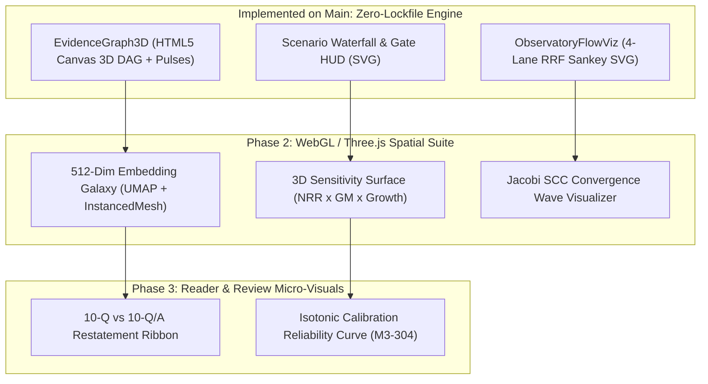

# Visualization, 3D Graphics, and Interactive Gamified UX Roadmap

Relevant source files

- [apps/web/src/components/EvidenceGraph3D.tsx](../../apps/web/src/components/EvidenceGraph3D.tsx) — 3D perspective provenance DAG and temporal cutoff explorer
- [apps/web/src/components/ObservatoryFlowViz.tsx](../../apps/web/src/components/ObservatoryFlowViz.tsx) — 4-lane RRF fusion flow and budget visualizer
- [apps/web/src/app/desk/DeskClient.tsx](../../apps/web/src/app/desk/DeskClient.tsx) — Earnings Update Desk, scenario waterfall chart, and review gates
- [apps/web/src/components/ObservatoryTrace.tsx](../../apps/web/src/components/ObservatoryTrace.tsx) — Search Observatory trace view
- [evals/reporting/corpus_qa_render.py](../../evals/reporting/corpus_qa_render.py) — deterministic stdlib SVG and Markdown renderer

Source references verified against commit `f4b1197`. Fixture-status notes in
sections 3A–3C checked against `f3e9452`.

This document audits the visual surfaces in Financial Evidence Lab, defines the
architecture for interactive 2D charts, 3D spatial graphics, and game-like
analytical mechanics, and documents both the **zero-dependency interactive
3D/2D components implemented in `apps/web`** and the roadmap for full WebGL /
Three.js expansion.

---

## 1. Audit of Existing Visual Surfaces

Prior to the interactive visualization layer, the codebase relied almost
exclusively on semantic HTML tables and definition lists:

| Surface | Key Files | Prior Representation | Opportunity for Visual & Spatial Upgrade |
| :--- | :--- | :--- | :--- |
| **Earnings Update Desk (`/desk`)** | `apps/web/src/app/desk/DeskClient.tsx` | Static text cards (`$842.4m`, `7 / 9 cells linked`) and a 1D CSS bar (`.coverage-bar`). | **3D Epistemic Lineage Constellation** + **Interactive Scenario Waterfall Bridge** + **Temporal Cutoff Scrubber** + **Gamified Review Gate HUD**. |
| **Search Observatory (`/observatory`)** | `apps/web/src/components/ObservatoryTrace.tsx`, `RunComparison.tsx`, `EventReplay.tsx` | Five stacked HTML `<table>` / `<ol>` sections for 4-lane candidates, RRF scores, rejections, claims, and budgets. | **Interactive 4-Lane RRF Fusion Sankey / Flow Arena** + **Visual Latency & Token Budget Gauges** + **Step-Through Replay Scrubber**. |
| **Evidence Reader (`/reader/[documentId]`)** | `apps/web/src/components/EvidenceReader.tsx`, `DocumentPane.tsx`, `FactPanel.tsx` | Left outline tree, middle text pane with `<mark>` highlights, right `FactPanel` list with duplicate tables. | **Minimap Span Density Bar**, **Amendment Diff Ribbon (`10-Q` → `10-Q/A`)**, and **Cross-Section Provenance Arcs**. |
| **Extraction Review (`/extractions`)** | `apps/web/src/components/extraction/ReviewQueue.tsx`, `RunEvents.tsx` | Checkbox `<table>` of proposals, `<fieldset>` conflict groups, and an SSE event table. | **12-Stage FSM Progress Map**, **Side-by-Side Conflict Diff Arena**, and **Isotonic Calibration Reliability Curve**. |
| **Offline Corpus QA (`evals/`)** | `evals/reporting/corpus_qa_render.py` | Byte-deterministic stdlib `xml.etree.ElementTree` horizontal stacked bar SVG (`2026-07-14-synthetic-cohort.svg`). | Extend deterministic SVG emitters to **Retrieval Recall@K Curves** and **Calibration Reliability Diagrams**. |

---

## 2. Core Principles: "Game-Like" Without Compromising Epistemic Rigor

Financial Evidence Lab is governed by strict constitutional invariants
([`constitution.md`](../../.specify/memory/constitution.md)): **Decimal-only math**,
**point-in-time temporal cutoffs (`published_at <= effective_as_of`)**,
**hash-verified citations**, and **fail-closed validation**. Making the
interface feel like a tactile strategy or investigation game must *reinforce*—never
obscure—those guarantees:

1. **Visuals never invent numbers.** Every bar height, 3D node position, or
   scenario delta is derived deterministically from typed `Decimal` strings or
   verified trace payloads. The desk's scenario waterfall and 3D lineage graph
   (sections 3A and 3B) do not meet this yet: they are illustrative fixture
   schematics until they are derived from `Decimal` strings or verified traces.
2. **Spatial depth maps to epistemic provenance.** In 3D space, the Y/Z axis
   represents the **Constitution II Four-Way Provenance Hierarchy**:
   - **Layer 0 (Bedrock):** Immutable SEC Filing Spans & XBRL Facts (`reported`)
   - **Layer 1 (Extraction & Claims):** Candidate Proposals, Conflict Groups, & Entailed Claims
   - **Layer 2 (Drivers & Formulas):** `AnalystAssumptionNode`, `OperationalDriverNode`, `ScenarioOverrideNode`, `ExpressionFormulaNode`, & `IterationGroup` (`assumption` / `derived`)
   - **Layer 3 (Crown):** `ReportedFinancialOutputNode` & `ValidationCheckNode`
3. **Accessibility and determinism remain mandatory.** Every `<canvas>` or
   `<svg>` visualization pairs with accessible ARIA controls, keyboard
   navigation, high-contrast theme support (`system`, `light`, `oled` clearing
   WCAG 2.2 AA in `apps/web/src/app/contrast.test.ts`), and `prefers-reduced-motion`
   awareness.

---

## 3. Implemented Interactive 3D & 2D Components in `apps/web`

Because `package.json` and `pnpm-lock.yaml` are protected `shared_paths` under
[`AGENTS.md`](../../AGENTS.md), `apps/web` ships a custom, dependency-free **3D
Perspective Canvas Engine + Interactive SVG Chart Suite** that runs
out-of-the-box in fixture and HTTP modes:

### A. 3D Evidence & Calculation Lineage Explorer (`apps/web/src/components/EvidenceGraph3D.tsx`)

Mounted on the **Earnings Update Desk (`/desk`)**, `EvidenceGraph3D` provides an
interactive, game-like 3D viewport over the CloudMetric Q2 FY26 update workflow.

**Status: illustrative fixture schematic.** In
`apps/web/src/components/EvidenceGraph3D.tsx` the output elevation, the
scenario label (`ScenarioOverride · ${scenario}`), and the FY27 revenue label
follow desk UI state, and the output sublabel switches between "Staged in this
session · fixture schematic" and "Preview · awaiting review gates".
Coordinates, span offsets, and the dollar figures are still fixture copy, not
read from a trace or the calculation engine, and no node carries a real
content hash.

- **Real-Time 3D Perspective Projection & Camera Orbit:** Drag to orbit in 3D
  (`yaw` / `pitch`), toggle between **3D Orbit**, **Layered DAG**, and
  **Cutoff Slice** camera presets, or toggle continuous orbital rotation.
- **Animated Provenance Energy Pulses:** Directional particles travel along
  dependency edges from SEC `10-Q` (`sec-10q-nrr`) and Earnings Call
  (`call-turn-48`) source spans up through the `C-104` NRR conflict node,
  `C-109` guidance nodes, operational drivers, and Base/Bull/Bear scenario
  overrides into the terminal `FY27 Revenue` output node.
- **Live Reactivity to Analyst Decisions:**
  - Before conflict resolution, the `C-104 NRR Conflict` node pulses amber
    with split provenance beams from both the `10-Q (108%)` and `Call (109%)`
    spans.
  - Choosing an authoritative source and saving the resolution in the `Review`
    tab locks the winning span's beam in emerald green (when temporally
    admissible under the cutoff) and dims the rejected source.
  - Approving both `C-109` guidance checkboxes and clicking **Apply approved
    facts** unlocks the full provenance chain and lights up the terminal `FY27
    Revenue` node.
  - Switching between **Base (`$842.4m`)**, **Bull (`$857.1m`)**, and **Bear
    (`$823.8m`)** updates the output node elevation and scenario delta.
- **Interactive Point-in-Time Cutoff Scrubber (`effective_as_of`):** Analysts
  can scrub the temporal cutoff across three stops (`Q2 Close (2026-07-31)`,
  `10-Q Filed (16:15 UTC)`, and `Post-Call (18:00 UTC)`) to see how
  `published_at <= effective_as_of` fences out future-dated evidence and
  invalidates future-dependent conflict decisions in real time.

### B. Interactive Scenario Waterfall & Guidance Corridor (`apps/web/src/app/desk/DeskClient.tsx`)

In the Update Desk **Model** view, an interactive SVG **Scenario Waterfall &
Guidance Corridor** chart visualizes the following.

**Status: illustrative fixture schematic.** Dollar amounts and bar heights are
fixture constants. `DeskClient.tsx` derives `outputTopY`, `overrideBarY`, and
`overrideBarHeight` from those heights. No dollar effect is computed from the
selected retention rate.

- The step-by-step buildup from **Q2 ARR Base (`$782.0m`)** → **Net
  Retention**, labelled with the selected source and rate only (`NRR 108% ·
  10-Q`, `NRR 109% · Call` or `NRR pending`), because no dollar effect is
  computed from the rate → **Scenario Override Delta (`Base` / `Bull` /
  `Bear`)** → **FY27 Projected Revenue (`$823.8m` – `$857.1m`)**, fixture
  totals.
- A **Review Gate Readiness HUD** in the Impact Inspector showing progress
  across Conflict Resolution (`C-104`), Revenue Guidance (`C-109-revenue`), and
  Gross Margin Guidance (`C-109-gross-margin`).

### C. 4-Lane RRF Fusion Flow & Budget Gauge (`apps/web/src/components/ObservatoryFlowViz.tsx`)

Mounted at the top of the **Search Observatory (`ObservatoryTrace.tsx`)**,
`ObservatoryFlowViz` turns raw `RetrievalTrace` data into an interactive visual
pipeline:

- **Multi-Lane RRF Flow Diagram (Sankey-style SVG):** Visualizes candidate
  counts and score ribbons flowing from **Dense**, **Lexical**, **Facts**, and
  **Tables** lanes into the **RRF (`k=60`) Fusion Nexus**, splitting into
  **Supported Set** versus **Gate Rejected** candidates, and terminating in
  **Supported / Flagged Claims**. The rejected box summarizes the rejection
  codes the trace actually carries (in the demo run `temporal_after_cutoff`,
  `cross_version` and `dedupe_near_duplicate`), with the exact codes in its
  tooltip.
- **Interactive Lane Filter:** Clicking any lane filter button highlights its
  Sankey flow ribbon and displays per-lane hit and supported-candidate counts.
- **Latency Stage Breakdown & Context Budget Bar:** Visualizes per-stage
  execution timings (`plan`, `retrieve`, `fuse`, `rerank`, `context`,
  `generate`, `verify`) and context item/token consumption against hard budget
  caps.

---

## 4. Next-Wave 2D, 3D & Shader Roadmap (Future Milestones)

When opening a `contract-change` ADR to expand frontend visualization packages
for M4/M5 completion, the following high-impact visual systems are recommended:

### 4.1 3D Embedding Point-Cloud "Observatory Galaxy" (`/observatory`)

- **Concept:** Project the 512-dimensional `pgvector` index (`0003_retrieval_core.sql`)
  into 3D coordinates using deterministic PCA/UMAP precomputed at index publish
  time.
- **Game Mechanic:** When a user submits a query in `/observatory`, the camera
  flies toward the query vector's coordinates. Candidates retrieved by the
  **Dense** lane ignite as blue stars, **Lexical** hits glow purple, **Facts**
  appear as crystalline octahedrons, and **Tables** render as structured grids.
  Items published after `effective_as_of` are visibly enclosed behind a
  translucent red **Temporal Cutoff Horizon Plane**.

### 4.2 3D Two-Way Sensitivity Surface & Monte Carlo Fan (`M4` / `M5`)

- **Concept:** Extend `fel_calculation_engine` scenarios from discrete
  `Base / Bull / Bear` tabs to a continuous 2-parameter grid (e.g., `NRR` on X,
  `New Bookings Growth` on Z, and `FY27 Revenue` or `Free Cash Flow` on Y).
- **Game Mechanic:** Render an interactive 3D topographic surface mesh with
  iso-contour lines marking covenant or guidance boundaries (`$790m–$794m`).
  Analysts can move a 3D cursor across the terrain to inspect exact 34-digit
  Decimal evaluations at any coordinate.

### 4.3 Jacobi Fixed-Point Iteration "Convergence Wave" (`M4`)

- **Concept:** `packages/calculation-engine/fel_calculation_engine/iteration.py`
  solves cyclic strongly connected components (`IterationGroup`) via Jacobi
  sweeps up to `max_iterations` against `abs_tol` and `rel_tol`.
- **Game Mechanic:** Visualize each Jacobi sweep $k = 1 \dots N$ as a damped
  harmonic wave or concentric ring contracting toward the tolerance target zone,
  giving analysts immediate intuition for why an interest/cash-sweep cycle
  converged in 5 iterations or why an unstable feedback loop hit
  `IterationConvergenceError`.

### 4.4 Restatement & Amendment Time-Lapse Ribbon (`/reader/[documentId]`)

- **Concept:** `apps/web/src/lib/amendments.ts` and `FactPanel.tsx` already link
  original filings (`10-Q`) to amendments (`10-Q/A`) and detect restated facts
  (`isRestatementGroup`).
- **Game Mechanic:** Add a split-screen **Amendment Diff Minimap** with curved
  Bezier ribbons connecting each original span to its restated counterpart,
  color-coded by magnitude delta ($\Delta$) and accompanied by a one-click "Diff
  Time-Jump" toggle.

## Related pages

- [Architecture overview](overview.md)
- [Executive architecture brief](executive-brief.md)
- [System design](system-design.md)
- [Calculation engine](../../packages/calculation-engine/README.md)
- [Local development](../development/local.md)
