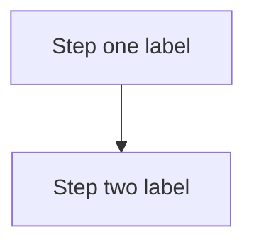

# Page title

<!--
Template for repository documentation pages (package READMEs, architecture,
development guides, runbooks). Copy this file, then delete every comment.

Title: one H1, a plain noun phrase ("Workers", "Testing guide"). No status
words or issue numbers in the title.
-->

Relevant source files

<!--
List the files a reader would open to check this page, most important first.
Use links relative to this page (for example `../../workers/src/...`), never
GitHub URLs. One line each: the path, an em dash, what the file holds.
-->

- `path/to/file.py` — what it holds (write each path as a relative link)
- `path/to/other.md` — what it holds

Source references verified against commit `<sha>`.

<!--
Replace <sha> with the short commit you read the sources at. Update it whenever
you re-check the references; a stale SHA tells readers how old the list is.
-->

One or two paragraphs: what this is, who it is for, and its scope. Say what the
page does not cover and where that lives instead. State current maturity
plainly — implemented, mock-only, or planned.

<!--
Contents: pages over ~300 lines get a "## Contents" list here, after the intro.
List H2s only; add H3s only when there are fewer than ~6 H2s. Anchors follow
GitHub's slug rules: lowercase, punctuation removed (backticks, dots, colons,
em dashes), each space becomes a hyphen, duplicates get -1, -2.

## Contents

- [First section](#first-section)
- [Related pages](#related-pages)
-->

## First section

<!--
Sections: H2 for topics, H3 for subtopics. Keep claims verifiable from code;
prefer short and correct over complete and guessed.

Diagrams: add Mermaid only where there is a real flow (a job lifecycle, a
request path). Use top-down `flowchart TD` (or `stateDiagram-v2` for a state
machine), node labels of three or four words, and a one-sentence caption
directly below the diagram.

Tables: use a table for configuration, environment variables, routes, and API
parameters. Only list values the code actually reads.
-->

One-sentence caption describing what the diagram shows.

| Variable  | Read by | Purpose                 |
| --------- | ------- | ----------------------- |
| `FEL_...` | module  | what it controls        |

## Related pages

<!--
Every page ends here so no page is a dead end: parent overview, sibling
guides, runbooks, and the ADRs that govern the subject.
-->

- [Architecture overview](../architecture/overview.md)
- [Related guide](../development/local.md)
