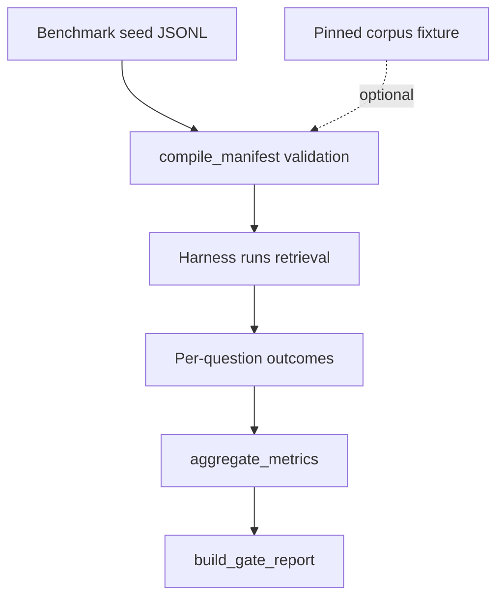

# Retrieval evals (`packages/retrieval-evals`)

<details>
<summary>Relevant source files</summary>

- [fel_retrieval_evals/compile.py](fel_retrieval_evals/compile.py) — seed-to-manifest compiler, checksum pinning, CLI
- [fel_retrieval_evals/models.py](fel_retrieval_evals/models.py) — typed seed records and manifest shapes (`m2-smoke-manifest/v1`)
- [fel_retrieval_evals/corpus.py](fel_retrieval_evals/corpus.py) — `Corpus` protocol and the JSON fixture `JsonCorpus`
- [fel_retrieval_evals/metrics.py](fel_retrieval_evals/metrics.py) — smoke thresholds, metric aggregation, gate report, reranker trigger
- [tests/](tests/) — compiler and metrics tests
- [evals/harness/retrieval_gate.py](../../evals/harness/retrieval_gate.py) — release-gate harness that uses this package
- [evals/datasets/benchmark-seed/questions.jsonl](../../evals/datasets/benchmark-seed/questions.jsonl) — the 65-question seed

</details>

Source references verified against commit `437ce55`.

`fel_retrieval_evals` is the tooling for the retrieval smoke benchmark. It
compiles the benchmark seed into a checksum-pinned manifest, and turns
per-question outcomes into the five exit-gate metrics graded against frozen
thresholds. It does not run retrieval itself; the harness in `evals/` does. This
page is for developers changing the benchmark, its validation rules, or its
thresholds.

The package has no `pyproject.toml`. It is imported from source through
`PYTHONPATH` (the root `pyproject.toml` pytest `pythonpath`, and the
`eval-retrieval-gate` Makefile target). `metrics.py` imports
`fel_retrieval.oracle`, so `packages/retrieval` must be on the path too.

## Flow



`evals/harness/retrieval_gate.py` compiles the seed with this package, runs
each question through `fel_retrieval`, and grades the outcomes with
`metrics.py`.

## Compiler

`compile_manifest(records, *, corpus=None, corpus_version_id=None)` validates
every record and raises one `CompilationError` listing all violations. Without
a corpus it runs structural checks only (record shape, numeric parsing, range
normalization, zero denominators, negative-case scope). With a `Corpus` it also
fails on temporal leakage and on golden quotes that resolve to zero or more
than one span. `load_and_verify_manifest(path)` recomputes the SHA-256 and
raises `ChecksumMismatch` if a committed manifest was edited by hand.

```sh
PYTHONPATH=packages/retrieval-evals .venv/bin/python -m fel_retrieval_evals.compile \
  evals/datasets/benchmark-seed/questions.jsonl --out .local/manifest.json \
  [--corpus corpus.json] [--corpus-version <id>]
```

## Gate metrics

Rates are exact `Decimal` values. `SMOKE_THRESHOLDS`:

| Metric                  | Threshold |
| ----------------------- | --------- |
| `temporal_validity`     | 1.00      |
| `numeric_accuracy`      | 0.99      |
| `entailment_precision`  | 0.95      |
| `citation_completeness` | 0.92      |
| `recall_at_10`          | 0.90      |

`reranker_triggered` is true when Recall@10 is below `0.90`. The report only
flags this; it never changes retrieval.

## Test

```sh
.venv/bin/pytest packages/retrieval-evals/tests
```

The full gate over the seed runs with `make eval-retrieval-gate`, which needs
`TEST_DATABASE_URL`.

## Related pages

- [System design: retrieval pipeline](../../docs/architecture/system-design.md#retrieval-pipeline)
- [Testing guide](../../docs/development/testing.md)
- [ADR-0006: observable retrieval](../../docs/decisions/ADR-0006-observable-retrieval.md)
- [ADR-0002: MVP stack](../../docs/decisions/ADR-0002-mvp-stack.md) — reranker trigger
- [Architecture overview](../../docs/architecture/overview.md)
