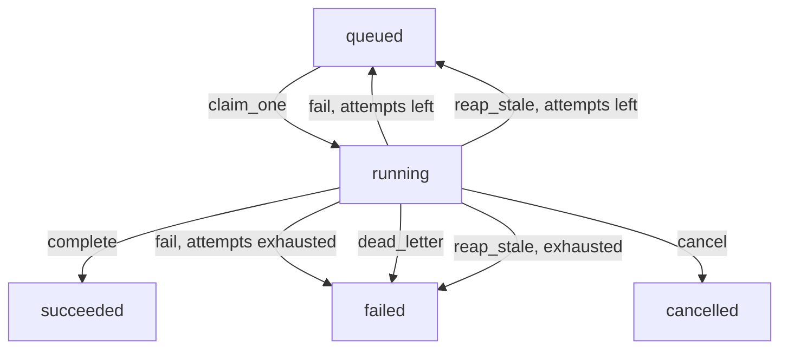

# Workers (`workers`)

<details>
<summary>Relevant source files</summary>

- [src/fel_workers/\_\_main\_\_.py](src/fel_workers/__main__.py) — process entrypoint, mode flags, fail-closed startup checks
- [src/fel_workers/consumer.py](src/fel_workers/consumer.py) — claim loop, job-kind dispatch, lease heartbeat, reaping
- [src/fel_workers/queue.py](src/fel_workers/queue.py) — PostgreSQL `SKIP LOCKED` queue: claim, complete, fail, dead-letter, cancel, reap
- [src/fel_workers/health.py](src/fel_workers/health.py) — `GET /health` liveness endpoint and watchdog
- [src/fel_workers/storage.py](src/fel_workers/storage.py) — local-directory blob storage and `FEL_WORKER_DB_ROLE`
- [src/fel_workers/ingestion/](src/fel_workers/ingestion/) — SEC discovery, fetch, company facts, parser, FRED and market adapters
- [src/fel_workers/extraction/](src/fel_workers/extraction/) — extraction workflow, roles, normalization, validators, budget, persistence
- [src/fel_workers/extraction/isotonic.py](src/fel_workers/extraction/isotonic.py) — offline `isotonic-v1` calibration primitive; no runtime caller yet
- [../infra/railway/worker.json](../infra/railway/worker.json) — Railway worker service build and start command
- [pyproject.toml](pyproject.toml) — package metadata and bundled data files
- [tests/](tests/) — worker test suite

</details>

Source references verified against commit `f4b1197`.

`fel-workers` is the asynchronous side of the platform. A worker process claims
jobs from the PostgreSQL `jobs` table and runs them outside the claim
transaction: SEC filing discovery, filing fetch and ingestion, company-facts
ingestion, and extraction runs. This page is for developers running or changing
a worker. Extraction operations (payload, budgets, review semantics) are in the
[extraction worker runbook](../docs/runbooks/extraction-worker.md); the
extraction architecture is in
[System design](../docs/architecture/system-design.md#extraction-boundary).

## Entrypoints

| Command                                                         | What it does                                                    |
| --------------------------------------------------------------- | --------------------------------------------------------------- |
| `python -m fel_workers`                                         | Heartbeat-only loop; logs and sleeps, claims nothing            |
| `python -m fel_workers run [--queue NAME] [--max-iterations N]` | Job consumer; `--queue` defaults to `ingestion`                 |

`run` checks its configuration before connecting to the database and exits 2
on any error. Flags accept `1`/`true`/`yes`/`on` (case-insensitive); any other
non-empty value, including `0`, is rejected. The `extraction` queue requires
`FEL_ALLOW_MOCK_LLM`, and that flag on any other queue is rejected too.

Exactly one provider mode must be set:

| Mode                 | Providers                                    | Requires                                 |
| -------------------- | -------------------------------------------- | ---------------------------------------- |
| `FEL_SEC_LIVE`       | Live EDGAR client with durable blob storage  | `FEL_STORAGE_DIR`, `FEL_SEC_USER_AGENT`  |
| `FEL_MOCK_SMOKE`     | Deterministic mocks; non-production smoke only | nothing else                           |
| `FEL_FIXTURE_INGEST` | Pinned local SEC bytes through the real ingestion pipeline; isolated acceptance only | `FEL_FIXTURE_DIR`, `FEL_STORAGE_DIR` |

## Queues and deployment

A worker serves one queue, chosen with `--queue` (default `ingestion`).
`sec_discovery` enqueues its `sec_filing_fetch` jobs on the queue the discovery
job was claimed from (`ingestion` on the deployed worker), and the
API enqueues every `extraction_run` on `extraction`. Model binding is scoped to the `extraction` queue: an
`ingestion` worker binds no model, and the only model an `extraction` worker
can bind is the deterministic mock behind `FEL_ALLOW_MOCK_LLM`.

The Railway worker service
([infra/railway/worker.json](../infra/railway/worker.json)) starts
`python -m fel_workers run` without `--queue`, so it serves `ingestion` only.
Hosted extraction is intentionally not deployed: no live model is bound until
#62, and no `extraction` worker service exists until #362. Hosted extraction
runs stay `queued` until both land.

## Job kinds

| Kind                | Handler                                                            |
| ------------------- | ------------------------------------------------------------------ |
| `sec_discovery`     | `ingestion/discovery.py`; enqueues `sec_filing_fetch` jobs         |
| `sec_filing_fetch`  | `consumer.handle_sec_filing_fetch`, then `ingestion/pipeline.py`   |
| `sec_company_facts` | `ingestion/company_facts.py`                                       |
| `extraction_run`    | `extraction/handler.py`; queue `extraction`                        |

FRED and market-data clients exist in `ingestion/`, but the consumer does not
dispatch any job kind to them yet. `extraction/isotonic.py` (the offline
`isotonic-v1` calibration primitive, documented in
[ISOTONIC.md](src/fel_workers/extraction/ISOTONIC.md)) is imported only by its
tests, not by runtime code. `forecasting/` is a placeholder package with no
code.

## Job lifecycle



Every write after the claim is fenced by the claim's lease, so a worker whose
claim was reaped cannot write a terminal state.

A failed attempt is requeued with capped, jittered exponential backoff. A
running job whose heartbeat is older than 60 seconds is reaped: requeued at
once while attempts remain, otherwise parked `failed` with `REAPED_EXHAUSTED`.
Cancellation is cooperative: the API sets `cancel_requested_at`, and handlers
poll it at stage boundaries.

## Environment variables

| Variable                        | Purpose                                                                 |
| ------------------------------- | ----------------------------------------------------------------------- |
| `FEL_DATABASE_URL`              | PostgreSQL connection URL (required for `run`)                          |
| `FEL_SEC_LIVE`                  | Live SEC mode; requires `FEL_STORAGE_DIR` and `FEL_SEC_USER_AGENT`      |
| `FEL_MOCK_SMOKE`                | Deterministic mock providers; non-production only                       |
| `FEL_FIXTURE_INGEST`            | Pinned local SEC bytes; requires `FEL_FIXTURE_DIR` and `FEL_STORAGE_DIR` |
| `FEL_FIXTURE_DIR`               | Fixture manifest and assets for `FEL_FIXTURE_INGEST`                    |
| `FEL_STORAGE_DIR`               | Durable blob directory; must be shared with the API                     |
| `FEL_SEC_USER_AGENT`            | SEC fair-access identity; must contain a contact address                |
| `FEL_ALLOW_MOCK_LLM`            | Binds the mock structured model; `extraction` queue only                |
| `FEL_EXTRACTION_MEMORY_STORES`  | Sends extraction output to in-memory stores, discarded on exit          |
| `FEL_WORKER_DB_ROLE`            | `SET ROLE` on every worker connection (for example `fel_worker`)        |
| `FEL_WORKER_HEALTH_PORT`, `PORT`| Port for `GET /health`; no server when both are unset                   |
| `FEL_SENTRY_DSN`                | Enables Sentry with PII off                                             |
| `FEL_SENTRY_TRACES_SAMPLE_RATE` | Sentry trace sample rate; defaults to `0`                               |
| `FEL_FRED_API_KEY`              | Read by the FRED client (`ingestion/fred.py`)                           |
| `FEL_ALPHAVANTAGE_API_KEY`      | Read by the market-data client (`ingestion/market.py`)                  |

## Run locally

See [Local development, Run the worker](../docs/development/local.md#run-the-worker)
for complete commands. The worker needs the same explicit `PYTHONPATH` as the
API, because `fel_workers.consumer` imports `fel_providers`, and the extraction
handler imports `fel_ontology`:

```sh
PYTHONPATH=apps/api:packages/providers:packages/retrieval:packages/ontology:workers/src \
  .venv/bin/python -m fel_workers run
```

## Test

```sh
.venv/bin/pytest workers/tests
```

Queue, lease, and persistence tests need `TEST_DATABASE_URL`; without it they
skip. See [Testing guide](../docs/development/testing.md#database-backed-tests).

## Related pages

- [Extraction operator notes](src/fel_workers/extraction/OPERATOR.md)
- [Extraction worker runbook](../docs/runbooks/extraction-worker.md)
- [API](../apps/api/README.md) — the service that enqueues and reads this work
- [System design: ingestion and evidence storage](../docs/architecture/system-design.md#ingestion-and-evidence-storage)
- [Architecture overview](../docs/architecture/overview.md)
- [Local development](../docs/development/local.md)
